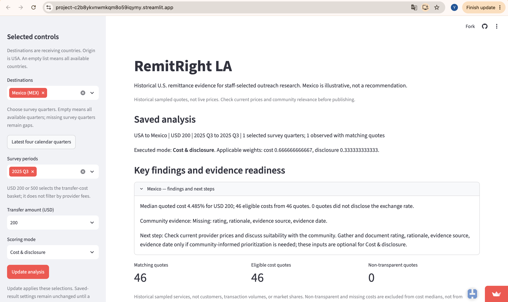
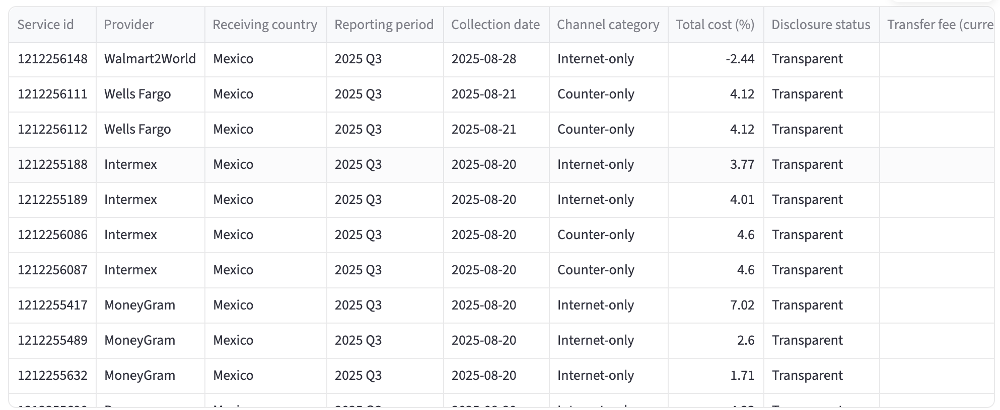
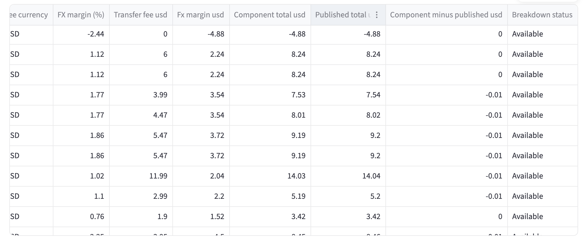

# Ana: choosing a USD 200 cash-pickup transfer to Mexico

**To Ana:** Use RemitRight LA to explore historical services, then compare current recipient amounts and confirm cash-pickup conditions with providers before choosing. Do not treat its historical cost ranking or sender-channel labels as a current, usable offer for your mother.

**Prepared by Yuqian Chen · November 8, 2026**

## 1. The person and the decision

Ana is a fictional Los Angeles resident who wants to send USD 200 to her mother in Mexico today. Her mother needs to collect the money in cash. Ana must decide which provider to use for this transfer; choosing poorly could leave her mother with less money or a service she cannot use. This is a difficult case at the boundary of RemitRight LA's intended use, which is historical research rather than live provider selection.

## 2. Their real situation and alternatives

Ana needs an actual transfer quote and a workable cash-pickup option. The CFPB explains that pre-payment information includes the exchange rate, fees/taxes and recipient amount; availability information also matters ([CFPB, Send money abroad with more confidence](https://www.consumerfinance.gov/consumer-tools/money-transfers/send-money-abroad-with-more-confidence/)). This supports comparing what her mother would receive, rather than choosing from a historical cost percentage alone.

An alternative is a provider's current estimator and agent locator. Western Union's Mexico page offers these tools and says cost depends on payment method, payout method and the exchange rate at transfer time. Its cash-pickup FAQ says recipients typically need valid ID and an MTCN at a participating agent. Ana should confirm an accessible location and timing with her mother ([Western Union, Send money to Mexico](https://www.westernunion.com/us/en/send-money-to-mexico.html)). This is an example alternative, not a recommendation or a claim that Western Union is cheapest. No live transaction quote has been collected for Ana.

**Sources:**

- Consumer Financial Protection Bureau, [Send money abroad with more confidence](https://www.consumerfinance.gov/consumer-tools/money-transfers/send-money-abroad-with-more-confidence/), accessed November 8, 2026. Supporting points: pre-payment price components and recipient amount; availability information.
- Western Union, [Send money to Mexico](https://www.westernunion.com/us/en/send-money-to-mexico.html), accessed November 8, 2026. Supporting sections: cheapest transfer, price estimator, and cash-pickup FAQ.

## 3. The app in use

**Live link:** https://project-c2b8ykvnwmkqm8o59iqymy.streamlit.app/

**What they select:** Mexico (MEX), survey period 2025 Q3, USD 200, Cost & disclosure mode. Click Update analysis. The saved analysis confirms one selected survey quarter, 2025 Q3; cost weight is 2/3 and disclosure weight is 1/3.



**Provider evidence, left-hand columns:** Same saved analysis: Mexico, 2025 Q3, USD 200, Cost & disclosure. The screenshot shows provider identity, historical collection date, sender channel, total cost and disclosure status. It is a partial view of the 46-row export.



**Provider evidence, right-hand columns:** The horizontally scrolled view shows FX margin and dollar cost breakdowns. Provider names are offscreen in this image; use the left view and preserved CSV for row identity. The first currency header is clipped, so currency should be checked in the full export rather than inferred from the cropped text.



**What they see:** The saved live result shows a 4.485% median quoted cost, 46 eligible costs from 46 quotes and zero quotes flagged for not disclosing the exchange rate. The overview explicitly warns that these are historical sampled quotes. The provider views retain collection dates and cost components; the complete export is preserved in `evidence/ana-provider-export.csv`.

## 4. Reading the result for their decision

**Does the number measure what this person cares about?** Only partly. The 4.485% median describes the historical USD 200 quotes selected, not today's best usable cash-pickup offer or the pesos her mother would receive. This is a date mismatch (kind 5) and a stand-in for her actual outcome (kind 3). The screen labels the data historical. The exported provider table contains dated service quotes, not a current quote for Ana.

**Who is in the rows, and who is not?** The exported table contains 46 Mexico service quotes labelled 2025 Q3. These are quotes, not 46 customers or transfers. Its columns contain no cash-pickup eligibility, payout location, recipient identification requirement or arrival-time field. Missing fields do not prove that providers lack these services; the export simply cannot establish which offers meet Ana's needs. The PDF identifies the USD 200 basket; the CSV itself has no transfer-amount column.

**What outside the data matters to this decision?** Current exchange rate, fees, recipient pesos, and cash-pickup availability matter, along with a reachable agent, required identification and timing. The CFPB and Western Union sources in Part 2 support these checks. Ana's mother's exact location and documents are not specified in this fictional case, so suitability remains unresolved.

**What could they wrongly conclude from it?** Ana might treat the lowest historical cost as today's cheapest usable offer, or interpret Internet-only as a statement about how her mother receives the money. Neither follows from the exported fields. Sender channel and recipient payout method are different questions. The app can help her explore historical services, but she still needs a current cash-pickup quote.

Check of the preserved live-app export, using Python's standard-library CSV reader and decimal median rather than the app's pandas calculation. Script: `verification/verify_ana_export.py`.

Command from the team repository:

```text
python3 cases/ana-cash-pickup/verification/verify_ana_export.py
```

```text
Rows: 46
Countries: Mexico
Periods: 2025 Q3
Eligible transparent costs: 46
Median total cost (%): 4.485
Collection dates: 2025-08-04 to 2025-08-28
```

This checks arithmetic on the exported values, not independent raw-workbook preparation or today's price. The script also prints every export column, allowing the missing payout-information fields to be checked.

## 5. The verdict: prove or break

**Verdict:** Ana cannot select a provider from this dashboard alone. RemitRight LA is useful as historical background and for identifying services to investigate, but the provider's current estimator and pickup information are more directly relevant to her final transaction decision. She must compare current recipient amounts and confirm cash-pickup conditions. This is a limitation for this difficult case, not proof that the historical research app computes its results incorrectly. The page already warns that quotes are historical; a change request, if adopted, should address the remaining payout-method ambiguity without pretending to supply live prices.

### CR-13: Clarify sender channel versus recipient payout method

- **From:** Yuqian Chen (YuqianC0724), 2026-11-08
- **Part:** RemitRight LA Streamlit provider evidence table and offline briefing
- **Evidence:** In the Ana case, the public dashboard was set to Mexico, 2025 Q3, USD 200 and Cost & disclosure. The saved result showed 46 quotes and a 4.485% median. The provider screenshot includes Walmart2World, collected 2025-08-28, labelled Internet-only. The complete 46-row CSV contains channel categories and historical cost components but no recipient payout method, pickup location, arrival time or recipient-ID requirements. Ana needs her mother to collect cash. Internet-only does not establish whether that requirement is met. Existing historical-price and row-order warnings help, but do not explicitly explain this distinction.
- **Change:** Add a short explanation next to the provider table and in the offline briefing: “Channel category describes how the sender accesses the service, not how the recipient receives the money. Confirm cash pickup, location, identification requirements and current prices with the provider.” Do not infer payout availability from the channel category or add unsupported live-price claims. Keep historical quotes, sorting, scores and calculations unchanged. This also helps researchers interpreting channel comparisons and does not change Elena's historical trend evidence.
- **Priority:** medium
- **Status:** open
