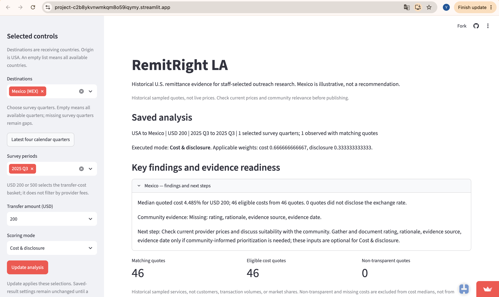
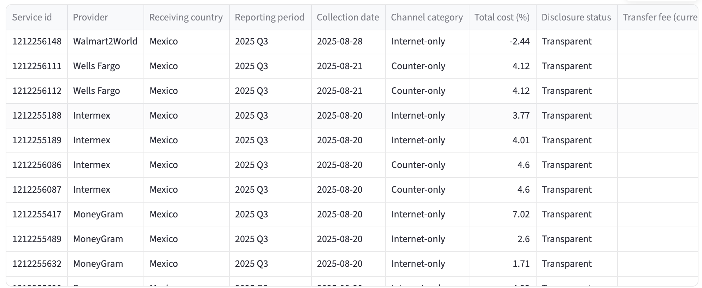
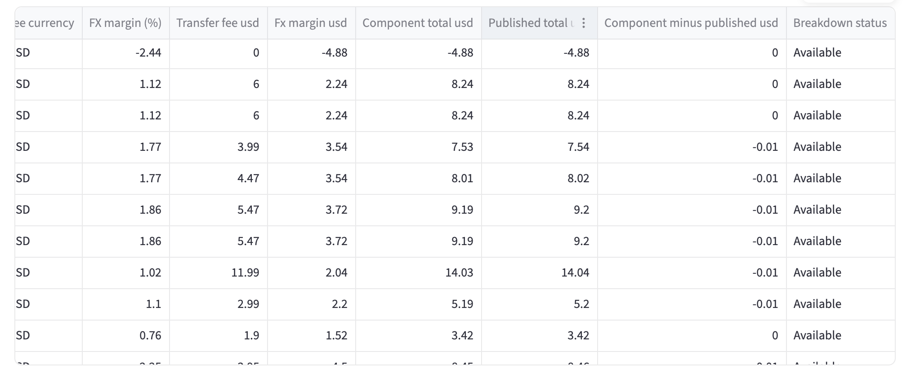

# Case: Ana choosing a provider for a USD 200 remittance to Mexico

> **Individual. Hand in one PDF file**, not this Markdown file: one case for **your team's
> app**, one specific person using it for one real decision, with screenshots of your team's
> **live app**. Upload the PDF to **Brightspace → Hand In Work** before Quiz 11. Your team also
> puts it in Section 2 (*Cases*) of its MVP `validation.pdf`, graded by MVP criteria 6 and 7 in
> `mvp.md` (in your section's repo). Full instructions: Module 11 handout, 11.7 and *What to hand in*. The four
> questions are in 11.1, and how to make the PDF is in 11.4.
>
> **Where to write.** Copy this file into your team's private repo, in any folder your team
> chooses, and rename it for your person, such as `ana-orders.md`. Save screenshots in a folder
> `screenshots/` next to it. Push as you go, so teammates can see your case.
>
> **In class, for Mei,** use `mei-case.md` in your section's repo instead: it is set up for
> copying in your `/class` answers.
>
> **Claim your person first.** Agree as a team who takes which person and decision, or fill in
> part 1, push this file and tell your teammates: the earlier claim keeps it. A case for the same
> person and decision as a teammate's earlier claim does not count. Together, the team's cases
> should cover your main kinds of users and at least one difficult case.
>
> Five parts: **1** the person and the decision; **2** their real situation and their
> alternatives, from at least two sources; **3** the app in use, with live-app screenshots; **4**
> reading the result for their decision; **5** the verdict: prove the app is as good as it gets
> for this person, or break it with a change request. Codex can find sources, take screenshots
> and make the PDF. What the result means for this person, and the verdict, are yours.

<!--
  How to fill it in:
  - All five parts are required. Replace every placeholder that says "Write" or "Paste",
    including the title. Keep the headings. The boxed lines,
    which start with >, may stay in the PDF; these comments do not show in it.
  - Show what you did and what you saw, not only a conclusion: the selections, the numbers on
    the screen, the source and what it says, the check you ran and its result.
  - Make the PDF as in handout 11.4, with the Markdown Preview Enhanced extension installed in
    VS Code: right-click in the file, "Markdown Preview Enhanced: Open Preview to the Side",
    then right-click in the preview, "Export -> Chrome (Puppeteer) -> PDF". Name it for your
    person, such as case-ana-orders.pdf. Open it and check that every screenshot is readable.
    If the export fails, ask Codex to fix it.
-->

## 1. The person and the decision

> **Enough:** a specific person and one decision your app is for, so that a reader who has never
> seen your project can picture it.

<!-- Who they are, with a name you make up and their job or situation; the decision; when it comes up;
     and what they lose if they decide badly. "A store manager" is too general; "Ana, who
     manages a grocery store and decides each Thursday how much fresh produce to order for the
     next week" is a person. A difficult case is welcome: a user the app serves badly, or one at
     the edge of what it is for. Two to four sentences. -->

Ana is a fictional Los Angeles resident who wants to send USD 200 to her mother in Mexico today. Her mother needs to collect the money in cash. Ana must decide which provider to use for this transfer; choosing poorly could leave her mother with less money or a service she cannot use. This is a difficult case at the boundary of RemitRight LA's intended use, which is historical research rather than live provider selection.

## 2. Their real situation and alternatives

> **Enough:** how this kind of person makes this decision today, what they are trying to
> achieve and what matters to them, and the alternatives they have to your app, from at least
> two sources you read.

<!-- Sources you can open free online: an official rule or government page, job postings, a news
     or trade article, the alternatives' own websites, or a forum where people in that role
     discuss the decision. Say which source each claim comes from.
     Say what matters to this decision that your app's data do not contain, such as a rule, a
     cost, the person's own circumstances or a recent change. Then name their alternatives: other tools or
     websites, other public data, people they can ask, or how they decide now. Part 5 compares
     your app with these. One or two paragraphs. -->

Ana needs an actual transfer quote and a workable cash-pickup option. The CFPB explains that pre-payment information includes the exchange rate, fees/taxes and recipient amount; availability information also matters ([CFPB, Send money abroad with more confidence](https://www.consumerfinance.gov/consumer-tools/money-transfers/send-money-abroad-with-more-confidence/)). This supports comparing what her mother would receive, rather than choosing from a historical cost percentage alone.

An alternative is a provider's current estimator and agent locator. Western Union's Mexico page offers these tools and says cost depends on payment method, payout method and the exchange rate at transfer time. Its cash-pickup FAQ says recipients typically need valid ID and an MTCN at a participating agent. Ana should confirm an accessible location and timing with her mother ([Western Union, Send money to Mexico](https://www.westernunion.com/us/en/send-money-to-mexico.html)). This is an example alternative, not a recommendation or a claim that Western Union is cheapest. No live transaction quote has been collected for Ana.

**Sources:**

- Consumer Financial Protection Bureau, [Send money abroad with more confidence](https://www.consumerfinance.gov/consumer-tools/money-transfers/send-money-abroad-with-more-confidence/), accessed November 8, 2026. Supporting points: pre-payment price components and recipient amount; availability information.
- Western Union, [Send money to Mexico](https://www.westernunion.com/us/en/send-money-to-mexico.html), accessed November 8, 2026. Supporting sections: cheapest transfer, price estimator, and cash-pickup FAQ.

## 3. The app in use

> **Enough:** your team's live link, what the person selects, at least one screenshot **of the
> live app** with the selections visible, and what they see, in your own words.

<!-- Take every screenshot from the live app at its public link, not from the app running on
     your laptop. (Mei's case in class is the exception: its screenshots are of the H-1B
     explorer on your laptop.) One block per screen,
     in the order the person would use them. Insert each screenshot with
     . If a selection does not show in the
     screenshot, write it in the line above the image. If a table is cut off, enlarge the window
     or take a second screenshot of the rest. -->

**Live link:** https://project-c2b8ykvnwmkqm8o59iqymy.streamlit.app/

**What they select:** Mexico (MEX), survey period 2025 Q3, USD 200, Cost & disclosure mode. Click Update analysis. The saved analysis confirms one selected survey quarter, 2025 Q3; cost weight is 2/3 and disclosure weight is 1/3.

<!-- Replace this image line with your own screenshot, one line per screenshot. -->


**Provider evidence, left-hand columns:** Same saved analysis: Mexico, 2025 Q3, USD 200, Cost & disclosure. The screenshot shows provider identity, historical collection date, sender channel, total cost and disclosure status. It is a partial view of the 46-row export.



**Provider evidence, right-hand columns:** The horizontally scrolled view shows FX margin and dollar cost breakdowns. Provider names are offscreen in this image; use the left view and preserved CSV for row identity. The first currency header is clipped, so currency should be checked in the full export rather than inferred from the cropped text.



**What they see:** The live-app PDF captured on November 8, 2026 at 1:58 pm shows a median quoted total cost of 4.485% for USD 200, with 46 eligible costs from 46 matching quotes and zero quotes flagged for not disclosing the exchange rate. These are historical 2025 Q3 quotes, not current prices. The page explicitly says to check current provider prices. Evidence source: `RemitRight LA · Streamlit1.pdf` supplied from the live URL. The overview screenshot confirms the selections and saved result. Both provider-table views are also embedded above, and the full provider export is preserved at `evidence/ana-provider-export.csv`.

## 4. Reading the result for their decision

> **Enough:** an answer to each question below, each backed by evidence: a number from the
> data, a rule, a source, or a check you ran.

<!-- Handout 11.1 gives the questions. Questions 1-3 are answered here; question 4 (better off
     than with the alternatives, and what not to use the app for) is part 5. The fourth prompt
     below asks how the person could misread the result, which part 5 then rules out. Handout 11.5 lists nine kinds of number that answer a
     different question: 1 one row per what, 2 which rows belong, 3 the real thing or a stand-in,
     4 a total or a rate, 5 which dates belong, 6 share of whom, 7 same mix, 8 were the groups
     alike before, 9 could it be luck. If a number the person relies on is one of these, name
     the kind, show the evidence, such as the line of code or a count from the data, and say
     what the right number is. For a rate from a small group (kind 9), say how many rows
     stand behind it. Then check whether it holds: compare it with the overall rate, or split
     the data by year. Or say that there are too few rows to tell. Codex can find the code
     behind a number and compute another
     version in a file you run; paste its code and output in the box. -->

**Does the number measure what this person cares about?** Only partly. The 4.485% median describes the historical USD 200 quotes selected, not today's best usable cash-pickup offer or the pesos her mother would receive. This is a date mismatch (kind 5) and a stand-in for her actual outcome (kind 3). The screen labels the data historical. The exported provider table contains dated service quotes, not a current quote for Ana.

**Who is in the rows, and who is not?** The exported table contains 46 Mexico service quotes labelled 2025 Q3. These are quotes, not 46 customers or transfers. Its columns contain no cash-pickup eligibility, payout location, recipient identification requirement or arrival-time field. Missing fields do not prove that providers lack these services; the export simply cannot establish which offers meet Ana's needs. The PDF identifies the USD 200 basket; the CSV itself has no transfer-amount column.

**What outside the data matters to this decision?** Current exchange rate, fees, recipient pesos, and cash-pickup availability matter, along with a reachable agent, required identification and timing. The CFPB and Western Union sources in Part 2 support these checks. Ana's mother's exact location and documents are not specified in this fictional case, so suitability remains unresolved.

**What could they wrongly conclude from it?** Ana might treat the lowest historical cost as today's cheapest usable offer, or interpret Internet-only as a statement about how her mother receives the money. Neither follows from the exported fields. Sender channel and recipient payout method are different questions. The app can help her explore historical services, but she still needs a current cash-pickup quote.

Check of the preserved live-app export, using Python's standard-library CSV reader and decimal median rather than the app's pandas calculation. Script: `verification/verify_ana_export.py`.

Command from the team repository:

```text
python3 cases/ana-cash-pickup/verification/verify_ana_export.py
```

```text
Rows: 46
Countries: Mexico
Periods: 2025 Q3
Eligible transparent costs: 46
Median total cost (%): 4.485
Collection dates: 2025-08-04 to 2025-08-28
```

This checks arithmetic on the exported values, not independent raw-workbook preparation or today's price. The script also prints every export column, allowing the missing payout-information fields to be checked.

## 5. The verdict: prove or break

> **Enough:** whether this person is better off with the app than with the alternatives in
> part 2, the app's place among them, and what they must not use it for. Then **either**
> compelling evidence that, for this person, the app is as good as it gets with the data
> available, **or** a change request that makes it better for this case without being made
> only for this case or making other users' answers worse.

<!-- Saying plainly that the app should not be used for some decision is a finding, and counts in
     your favor. So is showing that it holds up: say what you checked and why nothing better is
     possible with the data. A change request can be a new number or view, a label, a warning,
     or removing something misleading; say whom else it affects, such as your teammates' cases
     and the app's other users, and why it does not hurt them. Paste it as it appears in
     change-requests.md, or delete the box if you prove the app. -->

**User-confirmed conclusion:** Ana cannot select a provider from this dashboard alone. RemitRight LA is useful as historical background and for identifying services to investigate, but the provider's current estimator and pickup information are more directly relevant to her final transaction decision. She must compare current recipient amounts and confirm cash-pickup conditions. This is a limitation for this difficult case, not proof that the historical research app computes its results incorrectly. The page already warns that quotes are historical; a change request, if adopted, should address the remaining payout-method ambiguity without pretending to supply live prices.

```markdown
### CR-13: Clarify sender channel versus recipient payout method

- **From:** Yuqian Chen (YuqianC0724), 2026-11-08
- **Part:** RemitRight LA Streamlit provider evidence table and offline briefing
- **Evidence:** In the Ana case, the public dashboard was set to Mexico, 2025 Q3, USD 200 and Cost & disclosure. The saved result showed 46 quotes and a 4.485% median. The provider screenshot includes Walmart2World, collected 2025-08-28, labelled Internet-only. The complete 46-row CSV contains channel categories and historical cost components but no recipient payout method, pickup location, arrival time or recipient-ID requirements. Ana needs her mother to collect cash. Internet-only does not establish whether that requirement is met. Existing historical-price and row-order warnings help, but do not explicitly explain this distinction.
- **Change:** Add a short explanation next to the provider table and in the offline briefing: “Channel category describes how the sender accesses the service, not how the recipient receives the money. Confirm cash pickup, location, identification requirements and current prices with the provider.” Do not infer payout availability from the channel category or add unsupported live-price claims. Keep historical quotes, sorting, scores and calculations unchanged. This also helps researchers interpreting channel comparisons and does not change Elena's historical trend evidence.
- **Priority:** medium
- **Status:** open
```
