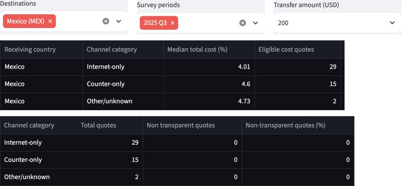
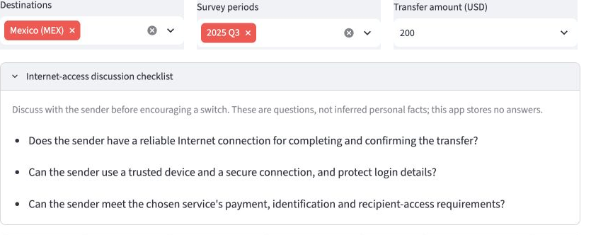

# Ana's Mexico remittance workshop

**Bottom line:** Use the online-versus-counter comparison as one section of a broader workshop. Combine it with current provider quotes and conversations about participants' circumstances. The app does not establish guaranteed savings, channel popularity or who should switch online.

## 1. The person and the decision

Ana is an illustrative outreach researcher at CHIRLA, not an interviewed employee. Before preparing a workshop for people sending money from the United States to Mexico, she must decide whether online-versus-counter costs should be its main focus. Choosing poorly could use limited workshop time on advice that offers little practical benefit or does not fit participants' circumstances.

## 2. Their real situation and alternatives

CHIRLA's [Community Education & Outreach](https://www.chirla.org/what-we-do/programs-initiatives/community-education-outreach/) page includes financial literacy and consumer protection workshops. It lists "Financial access and literacy," supporting this case's setting without establishing that CHIRLA currently runs this particular workshop.

Ana's alternatives include investigating the World Bank price database directly, comparing current provider quotes and talking with participants. The World Bank's [Remittance Prices Worldwide methodology](https://remittanceprices.worldbank.org/methodology) describes its prices as a "snapshot of a moment in time" and explains that costs include fees and exchange-rate margins. Historical prices therefore need a current-price check. The Consumer Financial Protection Bureau (CFPB)'s [Problems sending money to another country?](https://www.consumerfinance.gov/consumer-tools/sending-money/) describes the information generally available before payment: costs, exchange rates and the expected recipient amount. Its guidance says consumers "can shop around and compare costs with other companies." These quotes can support current choices; participant discussions can address needs and stable, secure internet access absent from the price data. These discussions are proposed, not interviews conducted for this case.

## 3. The app in use

**Live app:** [RemitRight LA](https://project-c2b8ykvnwmkqm8o59iqymy.streamlit.app/), checked November 7, 2026.

**Selections:** United States origin; Mexico; Q3 2025; USD 200 basket; Cost & disclosure mode. Click **Update analysis**, then **Channels**. No community rating is required for this comparison.

| Channel | Eligible / total quotes | Median total cost |
|---|---:|---:|
| Internet-only | 29 / 29 | 4.01% |
| Counter-only | 15 / 15 | 4.60% |
| Other/unknown | 2 / 2 | 4.73% |

There are no Mixed quotes. All 46 quotes are eligible, with an overall median of 4.485%. Counter minus Internet is **0.59 percentage points**, equivalent to **$1.18 on $200**. These are separate groups of historical service quotes.

<!-- PAGEBREAK -->

**Live-app evidence: channel comparison and access questions**



*Figure 1. All columns of the live channel table, arranged in two panels with channel labels repeated for readability. The selections above the table show Mexico, Q3 2025 and USD 200; the mode is Cost & disclosure.*



*Figure 2. The checklist asks about reliable internet, a trusted device and secure connection, and payment, identification and recipient requirements. The app does not infer or store participants' answers.*

Both figures use genuine public-app screenshots, cropped and arranged for readability. Original captures are retained; no values or wording were changed.

<!-- PAGEBREAK -->

## 4. Reading the result for their decision

**Does it measure what Ana cares about?** The $1.18 difference gives Ana a concrete cost example for one section of the workshop. It measures the difference between two group medians, not what a particular participant would save. It is insufficient on its own to choose the workshop's main focus.

**Who is in the rows, and who is not?** This is Module 11 **Kind 1: one row per what?** One prepared row is a sampled provider/service observation containing costs for two transfer baskets. The view selects USA-to-Mexico observations from Q3 2025 and uses the $200 field. Medians require transparency and an observed cost; here all 46 qualify. The two Other/unknown observations remain separate from the 29 Internet and 15 Counter observations. These are quotes, not customers, completed transactions or identified Los Angeles workshop participants. More Internet quotes do not show more users or more frequent sending.

**What outside the data matters?** Whether a person has stable, secure internet access matters before discussing a switch. The checklist prompts this conversation but does not answer it. Participants' circumstances and current provider prices must be checked separately, consistent with the World Bank's snapshot limitation and the CFPB's comparison guidance in Part 2.

**What could Ana wrongly conclude?** Both that everyone will save $1.18 by switching online and that more Internet quotes mean more people use online services. Neither follows from these rows. Different services and customers may differ in other ways; this comparison does not establish that switching causes savings.

**Independent calculation:** The appendix includes the complete code and actual output from `check_ana_channels.py`. This uses sorted Decimal values rather than the app's pandas aggregation. It reproduced Internet 4.010% (29 quotes), Counter 4.600% (15), Other/unknown 4.730% (2), the overall 4.485% median and the $1.18 difference. No costs were excluded. Results matched the live display at its shown precision; minor floating-point tails in the CSV explain extra digits. This checks aggregation, not the original workbook cleaning, survey representativeness or today's prices.

## 5. The verdict: prove or break

The current comparison and access checklist are sufficient for one section of a broader workshop, when combined with current quotes and participant conversations. The dashboard puts medians, sample sizes, the dollar difference and suitability questions together, making the historical comparison easier to explain than examining the underlying World Bank records alone.

The independent calculation confirms the numbers used here. The visible sample counts, separate channel categories, causal warning and access checklist support the limited discussion use Ana needs. Current provider quotes remain necessary for current prices; participant conversations remain necessary for personal circumstances. The available quote data cannot settle those questions.

I would keep this feature for that limited purpose and make no additional change request for this case. Ana should not use it to promise savings, infer channel popularity, recommend that everyone switch, or choose the workshop's main topic on price evidence alone.


<!-- PAGEBREAK -->

### Appendix: independent calculation

Complete code for the check summarized in Part 4. Save it as `cases/check_ana_channels.py`. From the team repo, change into `prof-build-M2`, then run `uv run python ../cases/check_ana_channels.py`. The script reads prepared data and imports none of the app calculation functions.

```python
import csv
from decimal import Decimal
import gzip
from pathlib import Path
ROOT = Path(__file__).resolve().parents[1]
groups = {name: [] for name in ('Internet-only', 'Counter-only', 'Mixed', 'Other/unknown')}
counts = dict.fromkeys(groups, 0)
excluded = 0
def middle(values):
    ordered = sorted(values)
    n = len(ordered)
    return ordered[n // 2] if n % 2 else (ordered[n // 2 - 1] + ordered[n // 2]) / 2
with gzip.open(ROOT / 'prof-build-M2/data/rpw_usa_clean.csv.gz', 'rt', newline='') as source:
    for row in csv.DictReader(source):
        if (row['source_code'], row['destination_code'], row['period']) != ('USA', 'MEX', '2025_3Q'):
            continue
        words = {part.strip().lower() for part in row['access_point'].split(',') if part.strip()}
        known = {'internet', 'agent', 'bank branch', 'post office branch', 'call center'}
        online = 'internet' in words
        counter = bool(words & {'agent', 'bank branch', 'post office branch'})
        channel = ('Other/unknown' if not words or words - known else
                   'Mixed' if online and counter else 'Internet-only' if online else
                   'Counter-only' if counter else 'Other/unknown')
        counts[channel] += 1
        value = row['cc1_total_cost_pct'].strip()
        if row['transparent'].strip().lower() != 'yes' or not value:
            excluded += 1
            continue
        cost = Decimal(value)
        if not cost.is_finite():
            raise ValueError('Nonfinite cost')
        groups[channel].append(cost)
print('USA to Mexico | USD 200 | Q3 2025')
print('Channel | total quotes | eligible costs | median cost (%)')
for channel, values in groups.items():
    median = f'{middle(values):.3f}' if values else 'Unavailable'
    print(f'{channel} | {counts[channel]} | {len(values)} | {median}')
delta = middle(groups['Counter-only']) - middle(groups['Internet-only'])
print(f'Counter minus Internet: {delta:.3f} percentage points')
print(f'Dollar equivalent: ${delta * Decimal(200) / 100:.2f}')
print(f'All-quote median: {middle([cost for values in groups.values() for cost in values]):.3f}%')
print(f'Excluded non-transparent or missing costs: {excluded}')
assert len(groups['Internet-only']) == 29
assert len(groups['Counter-only']) == 15
# Match the displayed precision; the prepared CSV retains floating-point tails.
assert middle(groups['Internet-only']).quantize(Decimal('.001')) == Decimal('4.010')
assert middle(groups['Counter-only']).quantize(Decimal('.001')) == Decimal('4.600')
assert delta.quantize(Decimal('.001')) == Decimal('0.590')
print('Comparison with live medians and counts: MATCH')
```

**Actual output:**

```text
USA to Mexico | USD 200 | Q3 2025
Channel | total quotes | eligible costs | median cost (%)
Internet-only | 29 | 29 | 4.010
Counter-only | 15 | 15 | 4.600
Mixed | 0 | 0 | Unavailable
Other/unknown | 2 | 2 | 4.730
Counter minus Internet: 0.590 percentage points
Dollar equivalent: $1.18
All-quote median: 4.485%
Excluded non-transparent or missing costs: 0
Comparison with live medians and counts: MATCH
```
