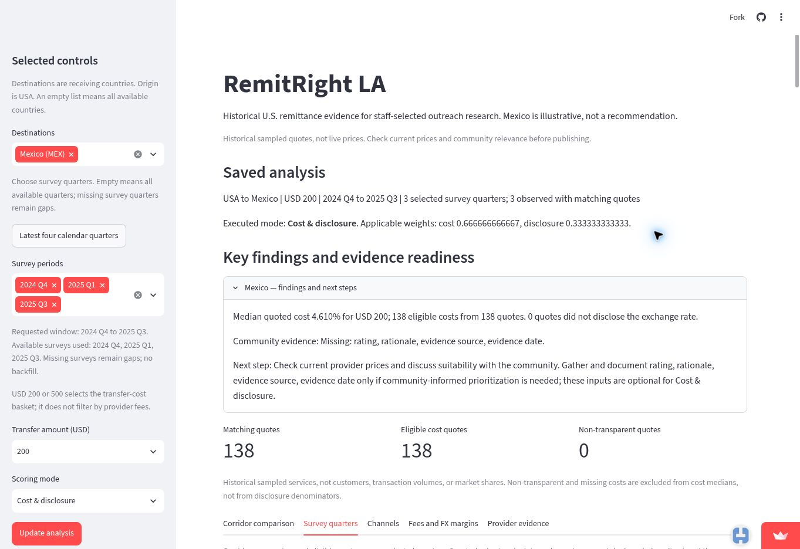
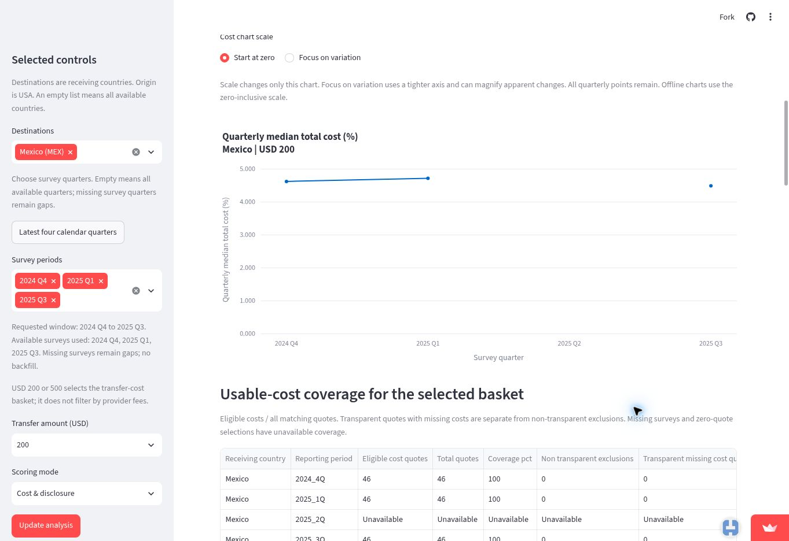
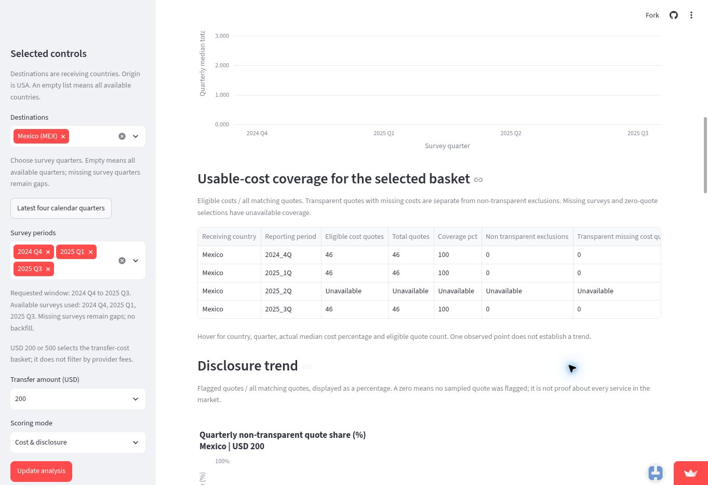
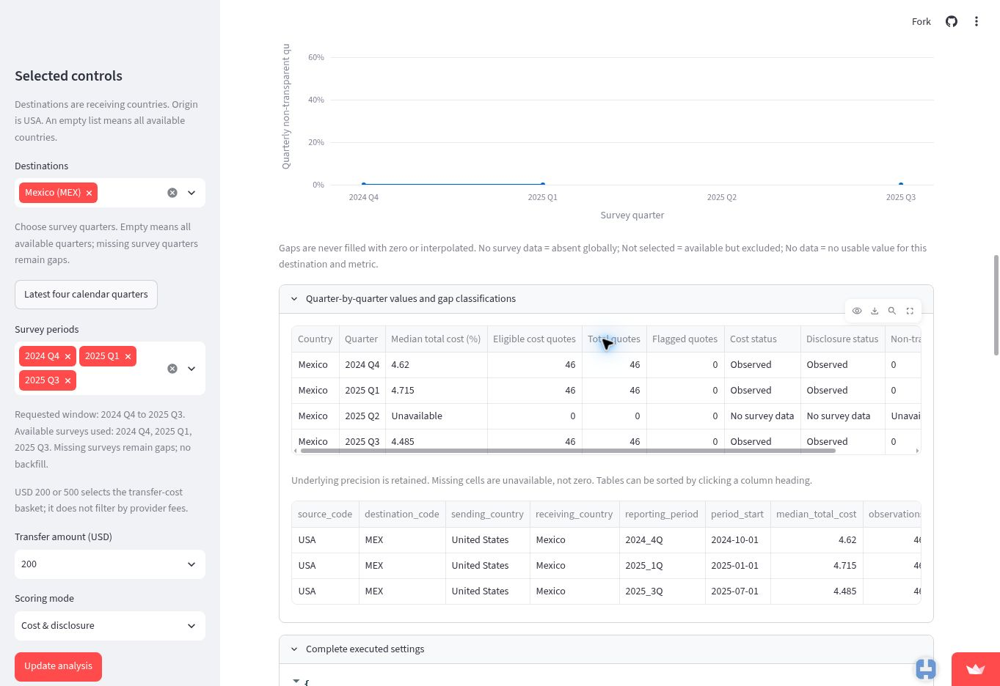
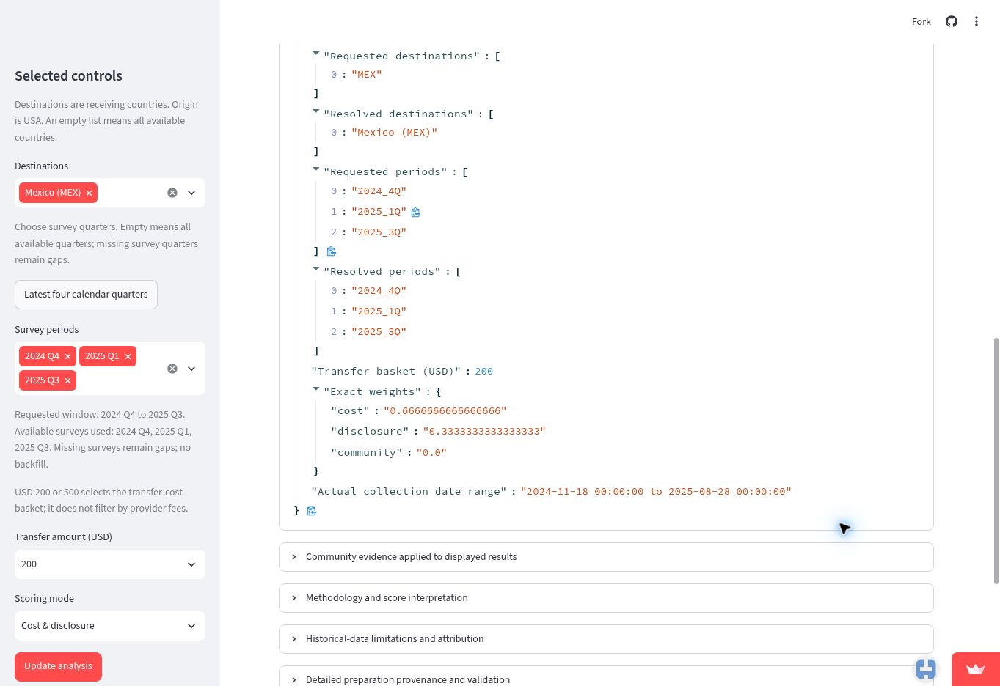
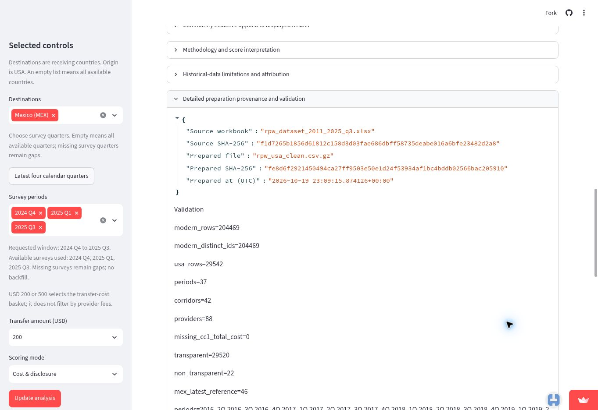

# Case: Elena - what historical remittance-cost claims can an advocacy briefing support?

**Publication recommendation.** Use the app to inspect and check a qualified description of historical USA-Mexico USD 200 quotes. Publish the three observed medians with the missing Q2 interval and service-comparability limitation; do not turn the lower endpoint into a consumer-savings, affordability or policy-effect claim.

## 1. The person and the decision

Elena is an **illustrative consumer advocate at the National Consumer Law Center (NCLC)** reviewing evidence for a hypothetical remittance advocacy briefing. Her decision is whether to publish a qualified description of quoted costs for sending USD 200 from the United States to Mexico between 2024 Q4 and 2025 Q3, seek further evidence, or omit the trend claim. An unsupported statement could misrepresent consumers' experience and weaken the briefing's argument.

Elena, this assignment and its publication process are illustrative; no interview, actual NCLC assignment, deadline or NCLC selection of Mexico is claimed.

## 2. Their real situation and alternatives

**Documented context.** NCLC's published advocacy uses attributed cost evidence and identifies limits to its interpretation. The October 2024 coalition letter cites a dated World Bank global USD 200 average and seeks fuller disclosure of charges and recipient amounts ([pp. 1 and 3](https://www.nclc.org/wp-content/uploads/2024/10/Oct-24-Letter-to-the-CFPB-Urging-Remittance-Regulations-Margot-Saunders.pdf)). More directly, NCLC's January 2023 letter explains that World Bank reports covering USD 200 and USD 500 do not capture the full range of transfer amounts, highlighting smaller transfers and requesting broader research ([p. 3](https://www.nclc.org/wp-content/uploads/2023/01/letter-remittances-1-11-23.pdf)). **Illustrative application:** Elena therefore asks whether her proposed statement identifies its measure, dates and population accurately, and whether missing observations or service differences require qualification. These are this case's review questions, not a documented NCLC publication procedure.

Mexico is a defensible bounded example: BBVA Research, using Banco de Mexico data, reports that the US supplied 96.6% of Mexico's remittance receipts in 2024. This supports corridor relevance, not generalization to every US-origin corridor. [NCLC-hosted coalition letter, October 28, 2024](https://www.nclc.org/wp-content/uploads/2024/10/Oct-24-Letter-to-the-CFPB-Urging-Remittance-Regulations-Margot-Saunders.pdf), [BBVA Research, Mexico: Record in remittances in 2024](https://www.bbvaresearch.com/en/publicaciones/mexico-record-in-remittances-64745-million-dollars-in-2024-and-dark-spots-for-2025/)

In this illustrative workflow, Elena uses the dashboard to inspect quarterly medians, coverage, missing periods and settings. She uses the frozen World Bank workbook for independent calculations and explicitly defined service-profile comparisons; those comparisons are separate from the dashboard and do not prove unchanged products. The [official corridor page](https://remittanceprices.worldbank.org/corridor/United-States/Mexico) supplies service details and collection dates, while [published RPW reports](https://remittanceprices.worldbank.org/sites/default/files/2026-04/RPW_main_report_and_annex_Q325.pdf) supply broader average-cost context, rather than confirmation of her corridor medians. All use quoted-price evidence: RPW describes snapshots and potentially untracked recipient charges ([methodology](https://remittanceprices.worldbank.org/methodology)). Claims about actual expenses or affordability would require transaction and household evidence beyond these sources.

**Sources:**

- Coalition letter hosted by NCLC: [Support for petition to address hidden and unnecessary fees in International Remittance Transactions](https://www.nclc.org/wp-content/uploads/2024/10/Oct-24-Letter-to-the-CFPB-Urging-Remittance-Regulations-Margot-Saunders.pdf), October 28, 2024. Page 1 cites cost research; page 3 requests fuller cost and recipient-amount disclosures. These establish advocacy context, not a current assignment or current-law finding.
- National Consumer Law Center (NCLC): [Our Request for Additional Information on International Remittances](https://www.nclc.org/wp-content/uploads/2023/01/letter-remittances-1-11-23.pdf), January 11, 2023. Page 3, including footnotes 6-8, identifies limitations of the USD 200/USD 500 report baskets and requests research across corridors, amounts, providers and urban/rural locations. This supports the evidence-review context, not an internal publication procedure.
- World Bank: [RPW Methodology](https://remittanceprices.worldbank.org/methodology). Explains sampling, snapshot limitations and potentially untracked recipient charges.
- BBVA Research: [Mexico: Record in remittances in 2024](https://www.bbvaresearch.com/en/publicaciones/mexico-record-in-remittances-64745-million-dollars-in-2024-and-dark-spots-for-2025/), February 4, 2025. Its key points report the US share of Mexico's 2024 receipts.
- World Bank: [USA-Mexico corridor](https://remittanceprices.worldbank.org/corridor/United-States/Mexico) and [RPW Issue 54, September 2025](https://remittanceprices.worldbank.org/sites/default/files/2026-04/RPW_main_report_and_annex_Q325.pdf). These provide alternative service-level evidence and published broader analysis.

## 3. The app in use

**Live link:** [RemitRight LA public dashboard](https://project-c2b8ykvnwmkqm8o59iqymy.streamlit.app/)

**What they select:** USA origin; Mexico (MEX) only; USD 200; Cost & disclosure; survey periods 2024 Q4, 2025 Q1 and 2025 Q3, within the requested 2024 Q4-2025 Q3 calendar window. Community evidence is missing and has zero weight; no community rating or composite score is used in this case. The cost chart uses Start at zero. The screenshots show the executed mode and periods, rather than only pending controls.

**Why this window:** it is the reproducible four-calendar-quarter window ending at the latest survey quarter in the frozen Q3 2025 release. It contains three observed surveys, with Q2 missing, and provides a bounded recent period for the publication decision. It is not a year-over-year comparison or evidence of a long-term trend; the longer-history check below tests sensitivity to its starting point.

**AI assistance:** ChatGPT captured the six public-dashboard screenshots supplied by the student. Codex assisted with research, calculations and editing. The author is responsible for reviewing the evidence and conclusions.

**What they see:**

| Quarter | Total quotes | Eligible USD 200 costs | Non-transparent exclusions | Transparent missing costs | Median quoted total cost |
|---|---:|---:|---:|---:|---:|
| 2024 Q4 | 46 | 46 | 0 | 0 | 4.620% |
| 2025 Q1 | 46 | 46 | 0 | 0 | 4.715% |
| 2025 Q2 | No survey observations | Unavailable | Unavailable | Unavailable | Unavailable |
| 2025 Q3 | 46 | 46 | 0 | 0 | 4.485% |

**Data version:** repository calculations used commit `208b0375` and its `prof-build-M2/data/rpw_usa_clean.csv.gz`. Its SHA-256 is:

```text
fe8d6f2921450494ca27ff9503e50e1d24f53934af1bc4bddb02566bac205910
```

This matches the live Prepared SHA-256 shown in Figure 6. The exact preparation-source workbook was independently retrieved and verified against its recorded fingerprint, and its relevant USD 200 records and medians were compared with the prepared data. These checks support the selected results, not the accuracy of every original market quote or the deployed code commit.



*Figure 1. Saved analysis: 138 matching and eligible quotes, zero non-transparent quotes. The displayed 4.610% is a pooled three-survey median, not a quarterly result or an average of quarterly medians.*



*Figure 2. Quarterly chart: the first two observed points rise; Q3 is lower, separated by a missing Q2 interval. The coverage table is partly cut off here; Figure 3 supplies its complete rows.*



*Figure 3. Each observed quarter has 46 eligible costs from 46 quotes, 100% sample coverage, zero non-transparent exclusions and zero transparent missing costs. Q2 coverage is unavailable. The complete column labels are Receiving country; Reporting period; Eligible cost quotes; Total quotes; Coverage percentage; Non-transparent exclusions; Transparent missing cost quotes. The rightmost screenshot header is clipped; these labels and the case results table supply the missing wording.*



*Figure 4. The flat 0% line shows the non-transparent quote share, not transfer costs. Zero applies to the observed quarters (2024 Q4, 2025 Q1 and 2025 Q3); 2025 Q2 has no survey observations. Exact displayed medians are 4.62%, 4.715% and 4.485%. Q2 is labelled No survey data. The zero counts displayed in that missing-quarter row mean no observations, not a zero price or measured market activity. The lower raw table contains only the three observed survey quarters.*



*Figure 5. Executed settings confirm MEX, the three requested/resolved surveys, USD 200, zero community weight and a collection-date range from November 18, 2024 to August 28, 2025. Figure 1 supplies the executed mode, which is above the captured portion of this settings panel.*



*Figure 6. The displayed Prepared SHA-256 matches the committed prepared CSV fingerprint reported in this case. The separate Source SHA-256 identifies the Excel workbook and is not the value used for the prepared-data comparison. Matching data fingerprints do not identify the deployed code commit.*

## 4. Reading the result for their decision

**Does the number measure what this person cares about?** It supports a limited publication statement: the middle quoted total-cost percentage among eligible sampled services in each observed quarter. It does not measure the typical customer's expense or the price change of a verified unchanged product. The independently calculated quarterly medians match Figure 4; Figure 3 confirms coverage. The pooled 4.610% in Figure 1 answers a different question and must not replace the quarterly series.

The dashboard supplies quarterly inspection, coverage, gaps, service evidence and saved settings. Service-profile matching and common-profile medians below were calculated separately from the data; they are not dashboard features.

**Who is in the rows, and who is not?** Rows are surveyed service quotes, not customers or completed transfers. All 46 recorded quotes are eligible in each selected observed quarter. This is complete usable-cost coverage within the samples, not complete market coverage. Actual transaction volumes, customers' choices and household resources are absent.

Equal counts conceal changes. The independent comparison uses seven fields: `firm`, `payment_instrument`, `access_point`, `pickup_method`, `cc1_lcu_code`, `cc1_lcu_amount` and `cc1_denomination_amount`. Each field is casefolded, whitespace is collapsed, comma-separated tokens are sorted and rejoined, and other spelling and punctuation are retained. There is no numeric recoding, provider aliasing or matching by quote ID. Prices and collection dates are excluded from the key. Each quarter has 46 unique keys, so no ambiguous matches were assigned. All 46 basic profiles match Q4 to Q1, but only 43 are common across all three surveys. Their medians are 4.610%, 4.700% and 4.600%. These profiles are not proven persistent product identities; transfer speed and other attributes can change. The different subset results show sensitivity to sample definition, not that composition caused the full-sample movement. A stricter sensitivity rule adds firm type, pickup location, transfer speed and receiving-network coverage: 31 profiles are common, with medians 4.610%, 4.590% and 4.370%. The matching rule therefore matters; neither subset is a validated fixed-product panel.

**What outside the data matters to this decision?** Publication scope matters: a description of sampled quotes needs different evidence from a claim about household affordability. RPW's snapshot design and potentially omitted recipient charges constrain interpretation ([World Bank methodology](https://remittanceprices.worldbank.org/methodology)). Causal explanations require additional evidence.

Starting-point sensitivity is material. Independent longer-history calculations, keeping the endpoint at 2025 Q3 (4.485%), show:

| Starting quarter | Starting median | Endpoint comparison |
|---|---:|---|
| 2023 Q4 | 4.300% | Final median higher |
| 2024 Q1 | 4.700% | Final median lower |
| 2024 Q3 | 4.485% | Same displayed median |
| Selected start: 2024 Q4 | 4.620% | Final median lower |

The verification script reports the full 37-quarter available history as well as these comparisons. This sensitivity check does not replace the selected window; it is independent calculated evidence rather than a dashboard screenshot.

**What could they wrongly conclude from it?** A lower final median could be mistaken for a steady decline, unchanged products becoming cheaper, consumer savings, improved affordability or a policy effect. Q1 is higher than Q4, Q2 is missing, service profiles differ and the data lack customer outcomes or a causal comparison. Relevant Module 11 issues include one row per what, the real thing or a stand-in, which dates belong and same mix.

**Reproducible independent check.** `cases/elena/verification/verify_elena_trends.py` is a clearly labelled reconstruction of the earlier in-memory investigation, rerun for this review. It uses only the Python standard library, reads the exact committed prepared-data blob, verifies its SHA-256, rejects duplicate profile keys, and imports no application calculation helpers. It checks prepared data; it does not repeat the earlier independent Excel-source comparison. Full saved output: `cases/elena/verification/elena-verification-output.txt`.

Run the verification script from the application folder, prof-build-M2. Regardless of the checked-out branch, it reads the frozen prepared CSV stored at commit 208b0375 through git show and requires the SHA-256 verified in the supplied live-dashboard screenshots. It does not read the working-folder CSV or establish the deployed code commit.

```text
uv run python ../cases/elena/verification/verify_elena_trends.py
```

The calculation and profile-key functions are:

```python
def median(rows):
    values = sorted(Decimal(row['cc1_total_cost_pct']) for row in rows if eligible(row))
    n = len(values)
    return (values[(n - 1) // 2] + values[n // 2]) / 2 if n else None

def normalized(value):
    tokens = (' '.join(token.casefold().split()) for token in value.split(','))
    return '|'.join(sorted(tokens))

def signature(row, fields=FIELDS):
    return tuple(normalized(row[field]) for field in fields)
```

Rerun output excerpt (costs in percent; differences in percentage points):

```text
QUARTERS: total eligible nontransparent transparent_missing median_pct
2024_4Q 46 46 0 0 4.620
2025_1Q 46 46 0 0 4.715
2025_2Q 0 0 0 0 Unavailable
2025_3Q 46 46 0 0 4.485
2025_2Q rows in complete committed USA data: 0

Pair matches: 2024_4Q 2025_1Q 46
Pair matches: 2025_1Q 2025_3Q 43
Basic profiles common to all three: 43
COMMON BASIC MEDIANS: period profiles median_pct
2024_4Q 43 4.610
2025_1Q 43 4.700
2025_3Q 43 4.600

START SENSITIVITY: start median_pct endpoint_minus_start_percentage_points
2023_4Q 4.300 0.185
2024_1Q 4.700 -0.215
2024_3Q 4.485 0.000
2024_4Q 4.620 -0.135
```

The Q2 zeros count records in this file; they are not observed prices or zero market activity. All selected observed rows are eligible, so the recorded-row and eligible-row profile populations coincide.

## 5. The verdict: prove or break

**Publication verdict: approve a narrowly descriptive statement.** The supplied live images confirm the quarterly values, coverage, executed settings and matching prepared-data fingerprint. The supported briefing statement is:

> In the checked World Bank RPW USA-Mexico USD 200 samples, median quoted total cost was 4.620% in 2024 Q4, 4.715% in 2025 Q1 and 4.485% in 2025 Q3. Each observed quarter contained 46 eligible quotes; 2025 Q2 was missing. The samples did not contain identical recorded service profiles, so these figures describe sampled quotes rather than a measured price change for unchanged products or consumers.

Elena is better equipped with the dashboard as an inspection and briefing tool combined with independent source checks. It brings quarterly results, coverage, explicit gaps and settings together. The official corridor page remains useful for service details; independent workbook calculations permit comparability checks; published reports provide broader context. This is a reasoned assessment of the app's features, not a measured productivity benefit. It does not establish individual savings, affordability improvements, nationwide trends or policy effects.

**Break finding:** the app correctly reports these sampled medians, but coverage counts alone do not show changes in service composition. Existing root requests CR-05, CR-06 and CR-09 address calendar selection, coverage and service-table exploration. The general limitation already says survey composition changes; a compact quarter-by-quarter composition comparison would make that warning more actionable. The recommended change below supplements those requests without changing data, scoring or existing medians.

**Change request**

```markdown
### CR-11: Show quarterly service composition beside historical trends

- **From:** Nicharee Ratanajaratkul (Prae), 2026-11-07
- **Part:** Survey quarters view and exported briefing.
- **Evidence:** The three selected Mexico quarters each contain 46 eligible USD 200 quotes, but separate analysis finds only 43 basic service profiles common across all three. Full-sample and common-profile medians differ.
- **Change:** Add per-quarter provider and payment/access/payout-category counts beside the cost and coverage evidence. Explain that equal counts do not establish unchanged services. Retain existing medians, expose missing categories and do not automatically assert product matches. This supports other corridors and historical users without changing scores or other users' answers.
- **Priority:** medium
- **Status:** open
```
