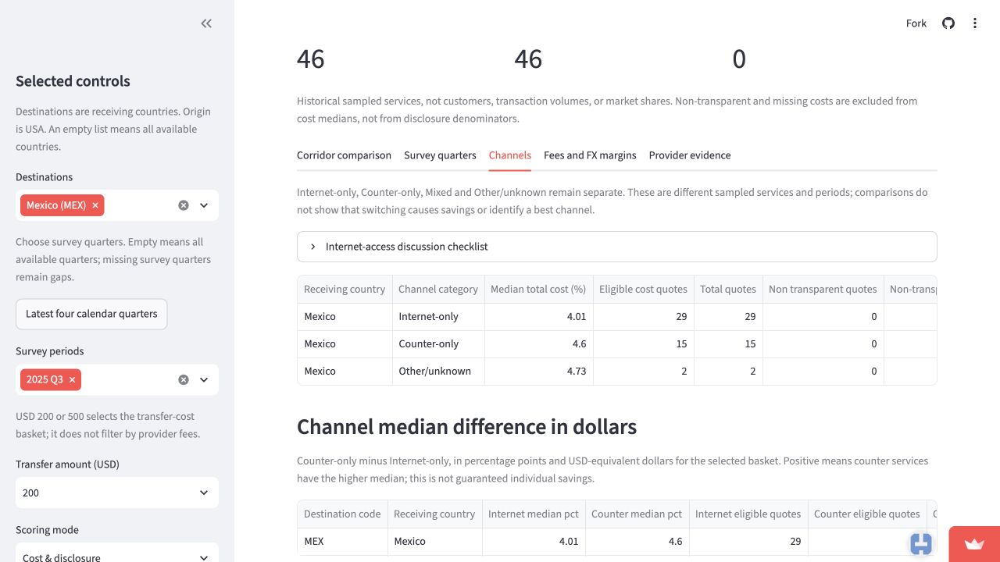
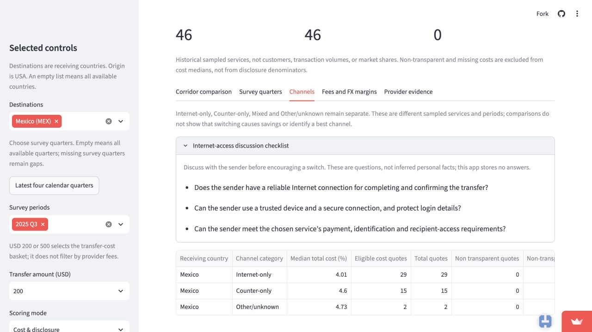

# Case: Ana’s Mexico remittance workshop

**Author:** Kanishk  
**Status:** Completed working record. The separate final memo and PDF are the submission versions.  
**Case claim:** Claimed with teammates by email. Ana is an illustrative persona, not an interviewed CHIRLA employee.

## 1. The person and the decision

Ana is an outreach researcher at CHIRLA planning a workshop for people sending money from the United States to Mexico. Before preparing the workshop, she must decide whether comparing online and counter remittance costs should be its main focus. A poor choice could use limited workshop time on advice that offers little practical benefit or does not fit participants’ circumstances.

## 2. Their real situation and alternatives

CHIRLA’s [Community Education & Outreach](https://www.chirla.org/what-we-do/programs-initiatives/community-education-outreach/) page describes presentations and workshops covering financial literacy and consumer protection. This supports the setting for Ana’s fictional case; it does not establish that CHIRLA currently runs this particular remittance workshop. Supporting text: “Financial access and literacy.”

Ana could use the World Bank’s [Remittance Prices Worldwide methodology and price database](https://remittanceprices.worldbank.org/methodology) to investigate sampled services directly, then compare current provider quotes. The World Bank describes its prices as a “snapshot of a moment in time.” Its methodology also explains that costs include the transfer fee and exchange-rate margin. These historical observations can guide research but cannot establish today’s cheapest service.

The CFPB’s [Problems sending money to another country?](https://www.consumerfinance.gov/consumer-tools/sending-money/) explains the information consumers generally receive before paying, including costs, the exchange rate and the amount expected to reach the recipient. Supporting text: “you can shop around and compare costs with other companies.” Current quotes and this guidance are an alternative to relying on the dashboard alone. Ana could also ask participants about their needs; that proposed conversation would supply information absent from the price dataset, including their access to stable, secure internet.

**Sources read:** CHIRLA, World Bank and Consumer Financial Protection Bureau, linked above; accessed November 6, 2026. The workshop decision is the case scenario, not a fact reported by these sources.

## 3. The app in use

**Live link:** [RemitRight LA](https://project-c2b8ykvnwmkqm8o59iqymy.streamlit.app/), checked November 7, 2026.

**Selections used:** Cost & disclosure mode; United States origin; Mexico destination; USD 200 basket; Q3 2025; click **Update analysis**, then **Channels**. No community rating is needed for this comparison. The optional ACS evidence concerns local population size; it does not establish workshop participants’ remittance use or internet access.

**What Ana sees:**

| Channel | Eligible cost quotes | Total quotes | Median total cost |
|---|---:|---:|---:|
| Internet-only | 29 | 29 | 4.01% |
| Counter-only | 15 | 15 | 4.60% |
| Other/unknown | 2 | 2 | 4.73% |

There are no Mixed quotes in this selection. Across all channels, the median is 4.485% from 46 eligible quotes; none are excluded for non-transparency or missing costs. The counter median exceeds the Internet median by **0.59 percentage points**, equivalent to **$1.18 on $200**. This compares separate groups of historical service quotes.



Opening the **Internet-access discussion checklist** shows questions about a reliable connection, a trusted device and secure access, and payment, identification and recipient requirements. The app states that it does not store answers or infer these personal circumstances.



Both screenshots are genuine captures from the public app, not a local run. The source and survey selections are written above because a screenshot cannot establish every setting on its own.

## 4. Reading the result for their decision

**Does the number measure what this person cares about?** The channel comparison should be one part of a broader workshop, rather than its main topic. The checked calculation measures the difference between the medians of two groups of eligible quoted costs: 4.60% minus 4.01%, or $1.18 on the selected $200 basket. It offers a concrete example for discussing costs, but does not measure how much a particular participant would save or how often participants send money.

**Who is in the rows, and who is not?** One prepared row is a sampled provider/service observation with costs for the two transfer baskets, not a sender or completed transfer. This view selects USA-to-Mexico quotes from Q3 2025 and the $200 cost field. Eligible medians use transparent quotes with observed costs; here all 46 qualify. The comparison uses 29 Internet-only quotes and 15 Counter-only quotes; two Other/unknown quotes remain separate. More sampled quotes do not demonstrate more customers, more frequent sending or a larger market share. These national corridor quotes do not identify Los Angeles workshop participants. Ana cannot use the larger Internet quote count to conclude that more participants use online services.

**What outside the data matters to this decision?** Your earlier concern was whether someone switching has access to a stable, secure internet connection. The live checklist now directly prompts this conversation, but supplies no participant-level evidence. Current provider prices also need checking: the World Bank identifies its observations as historical snapshots. The CFPB source in Part 2 describes comparing pre-transfer costs, exchange rates and expected recipient amounts. Your earlier assessment that the lower Internet median offers useful evidence is retained as a starting point, not treated as proof that participants should switch.

**What could they wrongly conclude from it?** Both claims would be misleading: that everyone will save $1.18 by switching online, and that more Internet quotes mean more people use online services. The $1.18 is a difference between two group medians, not a matched comparison of the same person's transfer. The counts describe sampled quotes, not customers. The live view explicitly cautions that these are different sampled services and that the comparison does not establish causation. Ana should present this as a historical comparison for discussion, not evidence of guaranteed savings or channel popularity.

**Independent check completed:** `check_ana_channels.py`, next to this case, reads the prepared gzip CSV using Python’s standard library and calculates medians with sorted Decimal values, without importing the dashboard’s calculation functions. The app groups eligible quote costs in `prof-build-M2/src/calculate_summaries.py`; `channel_cost_comparison` in `src/evidence_summaries.py` subtracts the Internet median from the Counter median and multiplies by the selected basket divided by 100.

**Compliance update:** The final memo explicitly identifies Module 11 Kind 1 (one row per what), includes the complete executable check and actual output in an appendix, and uses complete table captures arranged into readable panels. The original screenshots are retained. These changes add evidence without changing the student's verdict.

From the team repo, run:

```bash
cd prof-build-M2
uv run python ../project-dashboard/check_ana_channels.py
```

Actual output:

```text
USA to Mexico | USD 200 | Q3 2025
Channel | total quotes | eligible costs | median cost (%)
Internet-only | 29 | 29 | 4.010
Counter-only | 15 | 15 | 4.600
Mixed | 0 | 0 | Unavailable
Other/unknown | 2 | 2 | 4.730
Counter minus Internet: 0.590 percentage points
Dollar equivalent: $1.18
All-quote median: 4.485%
Excluded non-transparent or missing costs: 0
Comparison with live medians and counts: MATCH
```

The independent calculation matches the live counts and medians at displayed precision. The prepared CSV retains minor floating-point tails, so the comparisons round to the displayed precision. This verifies the aggregation from the prepared data, not the original workbook cleaning, survey representativeness or current prices.

## 5. The verdict: prove or break

**Your conclusion:** Online-versus-counter comparison should be one part of a broader workshop. The $1.18 difference is useful discussion evidence, rather than the sole basis for choosing the workshop’s main focus. Your earlier concern about stable, secure internet access remains part of assessing whether the comparison is useful to participants.

**Final verdict:** The current comparison and access checklist are sufficient for this limited use when combined with current provider quotes and conversations with participants. Compared with reviewing the World Bank data directly, the dashboard puts the channel medians, sample sizes, dollar difference and access questions together. Current quotes are still needed for today's prices, and participant conversations are needed for personal circumstances. The independent check confirms the displayed calculation, while the checklist and channel warning address the two misleading readings identified above. This supports keeping the feature for one workshop section; it does not establish that it can select the workshop's main topic or recommend that everyone switch. No additional change request is proposed for this case.

## Completion checklist

- Completed: verified public link and saved readable live screenshots with selections visible.
- Completed: recorded live figures and independently checked the calculation.
- Completed: your interpretations and verdict recorded in Parts 4 and 5.
- Final memo and PDF: `ana-mexico-workshop-final.md` and `case-ana-mexico-workshop.pdf`.
- Review and PDF rendering checks are recorded in `ana-case-review.md`.

This working record preserves the preparation and independent-check output. Submit the separate final PDF. Only case evidence and the independent check were added for this assignment; dashboard code and data were not changed.
