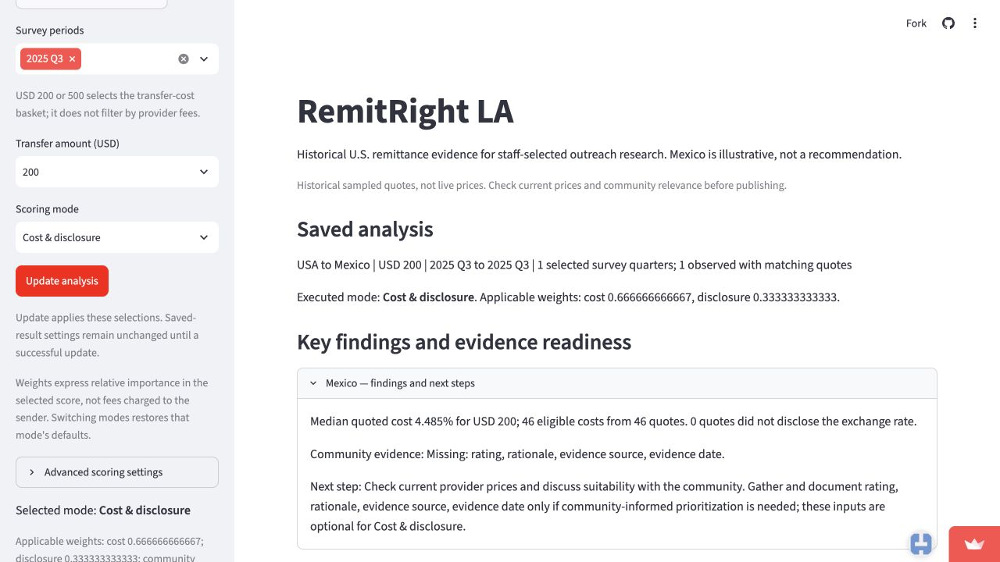
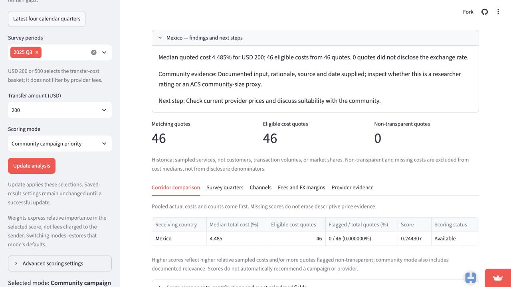

# 3. Numbers: are they right?

The checked dashboard calculations agree with independent calculations from the prepared quote data. This section defines the main measures, shows the results for the team's cases, and explains apparent differences that should not be treated as calculation errors. Correct arithmetic does not establish current prices, individual savings or the right campaign priority.

## 3.1 Data, method and evidence

We checked the prepared World Bank Remittance Prices Worldwide file used by RemitRight LA: **29,542 USA-origin service-quote records**, with 29,542 distinct service IDs, 37 survey periods and 42 destination corridors. Each row is a provider/service observation containing the two surveyed transfer baskets, not a customer or a completed transfer. All-country Q3 2025 selections contain **1,010 quotes**.

The independent checker reads the gzip CSV with Python's standard-library CSV reader. It groups records with dictionaries, sorts Decimal values to calculate medians, and computes counts, shares, dollar equivalents and weighted scores separately from the app's pandas calculations. Application functions are called only to produce the comparison values, not the independent answers. Exact counts and category states must agree; numeric values must agree within **0.000000001 in their stated units**, allowing harmless floating-point differences.

The verification is recorded at code commit `82200456fc44746f38ee354ac33142bc0255b023`. The checked prepared-file SHA-256 is:

```text
fe8d6f2921450494ca27ff9503e50e1d24f53934af1bc4bddb02566bac205910
```

**Reproduce:** from the team repository, run:

```text
cd prof-build-M2
uv run python ../verification/check_mvp_numbers.py
```

Evidence files:

- [Independent checker](verification/check_mvp_numbers.py).
- [Full comparison ledger](verification/mvp-number-comparisons.csv): selection, metric, independent value, application/case value and pass/fail result.
- [Run output](verification/mvp-number-output.txt) and [machine-readable summary](verification/mvp-number-summary.json).

The numerical sweep covers all corridors with records in Q3 2025 at both USD 200 and USD 500, default Cost & disclosure, community mode with and without ACS evidence, Mexico's latest-four-quarter window, and a historical Mexico selection with a non-transparent quote. It checks corridor, quarter and channel summaries; fee and FX summaries; fee minima, maxima and zero counts; service-level dollar breakdowns; reference bounds; scores; missing states; and calendar coverage. The ledger contains many scalar comparisons of these outputs, not that many independent surveys or test-suite cases.

## 3.2 Counts, eligibility and median total cost

**Total quotes** counts all matching service records, including non-transparent records and records missing a cost. **Eligible cost quotes** counts matching records marked `transparent = yes` with an observed cost for the selected basket. **Median total cost (%)** is the median of those eligible cost percentages. For an even count, the middle two costs are averaged. These are quote-weighted calculations, not customer- or transaction-weighted estimates.

**Non-transparent quote share** is the number marked `transparent = no` divided by **all matching quotes**, not by eligible cost quotes. The percentage display multiplies that fraction by 100. **Cost coverage (%)** is eligible cost quotes divided by all matching quotes, multiplied by 100. No denominator means unavailable, not zero.

| Selection | Independent result | Application result | Finding |
|---|---|---|---|
| Mexico, Q3 2025, USD 200 | 46 total; 46 eligible; median 4.485%; 0 flagged | Same | Match |
| Philippines, Q3 2025, USD 200 | 58 total; 58 eligible; median 3.960%; 0 flagged | Same | Match |
| Philippines, Q3 2025, USD 500 | 58 total; 57 eligible; median 2.860%; 0 flagged | Same | Match |
| Mexico, Q1 2017, USD 200 | 26 total; 25 eligible; median 4.760%; 1 flagged | Same | Match |

The older Mexico selection checks a real exclusion: the disclosure share is **1/26 = 3.846154%**, while the cost median uses 25 quotes. For the Philippines USD 500 selection, one transparent quote has no USD 500 cost: coverage is **57/58 = 98.275862%**, not 100%. A missing cost is not a zero-price offer. Source: the independent ledger and summary above.

The app's corridor ranking also matches the independent Q3 2025 USD 200 medians. The five highest are Afghanistan **8.875% (6 eligible quotes)**, Cuba **7.750% (4)**, Bangladesh **7.525% (24)**, Guyana **7.350% (21)** and Armenia **6.950% (16)**. Their small or unequal samples remain an interpretation limit; a correct ranking is not a measure of market size or need. These are the figures used in Jiayi Liu's case.

**Live cross-check, November 8, 2026:** [public dashboard](https://project-c2b8ykvnwmkqm8o59iqymy.streamlit.app/), USA to Mexico, Q3 2025, USD 200, Cost & disclosure. After Update analysis, the live view showed 46/46 eligible quotes, a 4.485% median and zero flagged quotes, matching the separate calculation.



## 3.3 Channel comparison and dollar difference

Channels describe **sender access**, not the recipient's payout method. Records with Internet access only are Internet-only; agent, bank-branch or post-office access without Internet is Counter-only; both is Mixed. Unrecognized or absent access descriptions remain Other/unknown, rather than being assigned to a preferred channel. Medians and eligibility use the same rules as the corridor view.

For the workshop case, Mexico, Q3 2025, USD 200:

| Channel | Total / eligible quotes | Independent median | Application median |
|---|---:|---:|---:|
| Internet-only | 29 / 29 | 4.010% | 4.010% |
| Counter-only | 15 / 15 | 4.600% | 4.600% |
| Other/unknown | 2 / 2 | 4.730% | 4.730% |

There are no Mixed quotes in this selection. Counter minus Internet is **4.600 - 4.010 = 0.590 percentage points**. Its dollar equivalent is **0.590 / 100 × USD 200 = USD 1.18**. Both the independent calculation and the application agree. This is a difference between medians of separate groups, not guaranteed savings from switching. The two Other/unknown quotes do not justify a broad claim about that category.

## 3.4 Quarterly trends, coverage and sample composition

Quarterly medians use eligible records **within each quarter**. A pooled multi-quarter median uses all eligible quote rows together; it is not an average of quarterly medians. The latest-four-calendar-quarter preset requests **2024 Q4, 2025 Q1, 2025 Q2 and 2025 Q3**. Because 2025 Q2 is absent from the prepared USA data, it remains a gap rather than being replaced by an older quarter.

| Mexico, USD 200 | Total / eligible quotes | Independent median | Application median / state |
|---|---:|---:|---|
| 2024 Q4 | 46 / 46 | 4.620% | 4.620% |
| 2025 Q1 | 46 / 46 | 4.715% | 4.715% |
| 2025 Q2 | No records | Unavailable | No survey data; no median |
| 2025 Q3 | 46 / 46 | 4.485% | 4.485% |

Observed-quarter cost coverage is 100%; coverage for the missing survey quarter is unavailable. Zero records in the file do not mean zero remittance activity or zero cost.

**Supporting Elena case calculation, not a built-in dashboard metric:** matching the seven recorded profile fields used in her case leaves 43 basic profiles common to the three observed quarters. Their medians are 4.610%, 4.700% and 4.600%, respectively. These independently reproduced figures differ from the full-sample medians because the populations differ. They do not demonstrate a dashboard error or prove unchanged products; field matches are not established product identities. The full-sample endpoint difference is **-0.135 percentage points**; the common-profile endpoint difference is **-0.010 percentage points**. A trend statement must identify which population it describes. The profile definition is preserved in the checker.

## 3.5 Fees, FX margins and service-level dollars

**Median transfer fee** is in the recorded fee currency; **median FX margin** is a percentage of the selected transfer basket. Each uses transparent records with an observed value for that component, grouped by corridor and fee currency. Their eligible counts can differ from the total-cost count. The checker independently reproduces these medians, component counts, fee minima/maxima and zero-fee counts.

For Afghanistan, Q3 2025, USD 200, the independent and application results are the same: **median fee USD 7.745**, **median FX margin 4.945%**, and six observed values for each. The total-cost median is **8.875%**. Adding the separate component medians gives **7.745/200 × 100 + 4.945 = 8.8175%**, which is a different calculation: a median of sums need not equal the sum of medians.

At service level, the checker verifies each displayed component from the corresponding prepared row:

```text
FX-margin dollars = FX-margin percent × selected basket / 100
Component total dollars = USD fee + FX-margin dollars
Published total dollars = published total-cost percent × basket / 100
Difference = component total dollars - published total dollars
```

Non-transparent, missing or non-USD fee components remain unknown/unavailable; the app does not invent conversions or substitute zero. Published totals and component-derived totals remain separate. In the checked Q3 records, their largest absolute difference is **USD 0.02**, for service ID `1212255537` at the USD 500 basket. The independent calculation reproduces that difference. The two fields describe different calculations from published components; source rounding may contribute, but its original cause was not independently established. This is not an unexplained discrepancy between the app and the independent method.

## 3.6 Relative cost and the two score modes

Relative cost is `(corridor median - reference minimum) / (reference maximum - reference minimum)`. The reference uses **all available USA-origin corridors for the selected periods and basket**, before filtering the countries displayed. It is not recalculated using only the visible shortlist. With fewer than two valid reference corridors it is unavailable; with equal reference medians it is zero, which does not mean free transfers.

For Q3 2025, USD 200, the independent reference bounds are **2.470% and 8.875%**, matching the application. Mexico's normalized cost is approximately **0.314598**.

| Mode and default formula | Mexico independent score | Application / live display |
|---|---:|---:|
| Cost & disclosure: `(2/3 × relative cost) + (1/3 × non-transparent share)` | 0.209732 | 0.209732 |
| Community campaign priority with ACS: `(0.50 × relative cost) + (0.25 × non-transparent share) + (0.25 × community input)` | 0.244307 | 0.244307 |

These are unitless weighted indices, not cost percentages, probabilities or provider recommendations. Higher values indicate higher relative costs/non-disclosure and, in community mode, a larger documented relevance input. The checker also confirms that community mode without required evidence gives an unavailable score, not zero, while Cost & disclosure needs no community rating. Valid weights must sum to one; inputs are not silently redistributed.

For ACS evidence, we checked the saved official [Census ACS 2024 five-year Table B05006, Los Angeles County](https://data.census.gov/table/ACSDT5Y2024.B05006?g=050XX00US06037). The source describes **2020–2024**, not a single 2024 census count. Mexico's country-of-birth estimate is **1,141,433**, with a **90% margin of error of ±9,233**; the county foreign-born total is **3,279,681**. The app's 0–5 rating is `5 × country estimate / county total`, then divided by five in scoring. The normalized input is therefore **0.348031714**, or **34.803171%**. This checks the arithmetic of a project-defined population proxy, not the validity of population as a measure of remittance need.

The independent mapping and raw-value checks reproduce 41 country matches; South Sudan remains unavailable instead of inheriting Sudan's population. Changing displayed countries leaves Mexico's ACS score unchanged. Sampling margins are displayed in the evidence, but not propagated into the composite score. Other researcher-supplied ratings remain judgments; their predictive or decision validity is not established by a numerical check.

**Live cross-check:** same Mexico, Q3 2025, USD 200 selection; choose ACS community-size proxy, Load community evidence, Community campaign priority, then Update analysis. The live score was **0.244307**, matching the independent calculation rounded to six decimals.



## 3.7 Checking the Philippines schedule comparison

Lea's case compares five USD 200 transfers with two USD 500 transfers, each schedule moving USD 1,000 in principal. Multiplying the two pooled median rates by USD 1,000 produces **USD 39.60** and **USD 28.60**, a **USD 11.00** gap. These medians use different eligible sets, so that gap is not a same-service saving.

The independent paired analysis retains only records with transparent, observed costs at **both** amounts. For each retained service, it calculates:

```text
Five-transfer cost = 5 × 200 × USD-200 cost percent / 100
Two-transfer cost = 2 × 500 × USD-500 cost percent / 100
Paired difference = 10 × (USD-200 cost percent - USD-500 cost percent)
```

There are **57 pairs**: **50** favor two larger transfers, **6** tie and **1** favors five smaller transfers. The median paired difference is **USD 13.10**. These reproduce Lea's reported check; they are supporting case calculations, not a paired-basket feature currently displayed by the dashboard. Differences smaller than USD 0.000000001 are treated as floating-point ties. The USD 13.10 paired median differs legitimately from the USD 11.00 difference between pooled medians: the calculations and eligible populations differ. Both assume historical terms repeated across installments, not guaranteed future prices.

## 3.8 Results, reconciliation and limits

The final run completed **20,194 scalar comparisons with zero failures**. The full ledger includes counts, numeric values, missing states and case-analysis comparisons. We also checked the preserved 46-row public provider export from the cash-pickup case: its median is 4.485%, matching the independently read Mexico data. Live checks of the Mexico baseline and ACS score agree with the separate calculations; other case screenshots and their recorded settings remain in [cases/](cases/README.md).

No application calculation changes were needed. Tiny binary floating-point tails are handled by the stated tolerance and display rounding. Missing evidence, missing quarters, different component medians, different eligible baskets and different service populations explain the apparent differences above; they are not filled, merged or relabeled to force agreement.

This verifies arithmetic on the specified prepared-data version and selections. It does **not** independently redo the source workbook extraction, verify every possible future filter/input combination, establish survey representativeness, confirm today's prices, validate personal circumstances, or prove that a score identifies the best campaign. Part 2 interprets fitness for users' decisions; Part 4 explains the regression tests. This section supplies the numerical evidence for those discussions.
