**INCOMPLETE TEAM REVIEW DRAFT - Section 3 is integrated; Section 4 (Tests) still awaits the team contribution.**

<!--
INTERNAL TEAM REVIEW - Not submission prose; excluded from rendered output.

Criterion 5: Design evidence still to resolve
* Confirm the team's primary use is historical investigation and message preparation;
  final campaign priorities require outside evidence and staff judgment. The original
  ambition was broader, and the difficult consumer cases are not all primary users.
* Research supports relevant activities, not the exact illustrative workflows.
  No interviews, adoption study, measured time/decision-quality benefit or verified
  organizational selection/publication procedure is supplied.
* Scoring weights are project choices, not validated user preferences. None of the
  submitted cases demonstrates live ACS-mode use or validates its outreach usefulness.
  Population context is not measured remittance use, attendance, need or benefit.
* Repository records do not explain why KNOMAD integration was omitted or the
  researcher-rating rubric postponed. Do not invent omission rationales.
* Current live acceptance and deployed code commit remain unverified by this review;
  code, local tests and a matching data fingerprint cannot establish deployment.

Criteria 6 and 7: Case coverage, fidelity and remaining evidence gaps
* Confirm coverage of the main research/education users and difficult decisions;
  five cases alone do not establish coverage of all important users or needs.
  Do not turn illustrative scenarios into actual assignments, deadlines or procedures.
* Screenshots are retained from submitted cases, not a new live session. Some source
  screenshots are cropped or partial. Retain their dates, stated selections, captions,
  tables and cropping qualifications; do not infer missing settings or redraw evidence.
  Extraction cannot recover content outside the original visible crop.
* Lea's original separate paired-basket script/output was not supplied with her case.
  Section 3 now independently reproduces its reported paired counts and median difference
  with verification/check_mvp_numbers.py. Her case text remains unchanged.
* The IFAD case's working memo and provider-level prepared-CSV investigation are
  unavailable. Its additional provider composition/payout evidence and CR-14 counts
  are not newly reproduced. Filing a request is not implementation evidence.
* Editorial renumbering: Jiayi's provider-breadth request uses shared-log CR-14,
  avoiding Elena's existing quarterly-composition CR-11. The author has corrected
  both occurrences in the individual PDF, including its historical preparation-status
  sentence, and renamed it Jiayi_Liu_Module11_Individual_Case_CR-14.pdf. The combined
  case also uses CR-14.
  CR-14 is open; its source did not specify priority, which the team must assign if needed.
* Preserve individual verdicts and qualifications. Historical results do not establish
  consumer savings, improved affordability, policy effects, transaction weights or
  identical products. Positive case assessments are task arguments, not measured
  benefits or proof of universal superiority over alternatives.

Completion and reproducibility
* Section 3 (Numbers) now includes measure definitions, populations, independent checks,
  source-version limits and discrepancy resolutions, plus two fresh live screenshots.
  Section 4 (Tests) remains incomplete: explain tested properties, worked examples,
  additions beyond the starting build, results and remaining risks.
* Preserve existing request statuses; undated deployment statements are not fresh
  acceptance evidence. The authoritative ledger is root change-requests.md;
  MVP_CHANGE_REQUESTS.md is implementation documentation and prof-build-M2/change-requests.md
  is the original build template. Supporting logs are not replacements for the ledger.
* External source URLs are retained, not all freshly availability-checked. Local targets
  are checked. PDF extraction provenance and prior preservation/visual checks remain in
  validation-draft-assets/extraction-map.json and preservation-check.json. The latter
  describes the earlier assembly, not a newly generated PDF or the latest Section 1.
* build_validation_draft.py reads validation.md and omits block HTML, including this
  review. Keep its assets. The authoring environment uses ReportLab, Mistune, pypdf,
  PDFium and Windows Calibri/Consolas fonts; review packages are in temporary PDF tooling.
  A fresh machine may need that environment; application dependencies are unchanged.
* Complete and review Sections 3 and 4 before making a final validation.pdf. No PDF is
  regenerated during this consolidation. validation.md is the single editable master.
-->

# Introduction

RemitRight LA supports outreach researchers and consumer educators investigating the cost of sending money from the United States to other countries. Our original ambition was to support campaign research and planning: identifying a corridor and a price issue worth explaining to a community. The contribution supported by our cases is more specific: investigating historical price concerns, preparing qualified educational or advocacy messages, and identifying questions for further research. Final campaign priorities require outside evidence and staff judgment. This scope develops the project's [original vision](00-vision.md) without treating a cost ranking as a complete decision rule.

The app uses prepared U.S.-origin service quotes from the World Bank's Remittance Prices Worldwide Q3 2025 release, including earlier survey quarters. These are historical observations, not current offers or records of customers' transactions. An optional Census American Community Survey input supplies Los Angeles County population context. It does not measure remittance demand or community need. The distinction matters because a price concern is useful evidence only when its dates, coverage and meaning fit the decision. [World Bank methodology](https://remittanceprices.worldbank.org/methodology); [Census Table B05006 definitions](https://api.census.gov/data/2024/acs/acs5/groups/B05006.html)

# 1. Design

## 1.1 A research workflow for outreach and education

Our primary users are staff researching outreach and consumer-education messages, with CHIRLA as the illustrative setting. CHIRLA documents financial-literacy and consumer-protection workshops, presentations and materials. That supports the educational context, without establishing an actual remittance campaign or organizational endorsement of this app. The design offers these researchers a sequence: **define a historical question, inspect costs and coverage, examine underlying quotes, and save a traceable briefing**. Its practical purpose is to make a proposed message and its supporting evidence inspectable before staff decide what to communicate. [CHIRLA, Community Education & Outreach](https://www.chirla.org/what-we-do/programs-initiatives/community-education-outreach/)

The five cases test this purpose and its boundaries. [Ana, the illustrative CHIRLA outreach researcher](cases/ana/ana-mexico-workshop-final.md), examines a channel comparison for a workshop; [Elena, the illustrative NCLC advocate](cases/elena/elena-remittance-trends-final.md), evaluates a qualified historical publication claim. NCLC's published advocacy identifies limits of remittance-cost evidence, supporting the need to check what a statistic can establish. [Ana, the illustrative IFAD project officer](cases/jiayi/Jiayi_Liu_Module11_Individual_Case.pdf), tests a secondary research-shortlisting use consistent with IFAD's research on costs, flows, regulations and market participants. These sources support relevant activities, not the invented assignments. A different [Ana, the fictional cash-pickup sender](cases/ana-cash-pickup/ana-mexico-remittance-final.md), and [Lea, the fictional sender comparing schedules](cases/lea/case-lea-remittance.pdf), show why historical summaries cannot settle current transactions. They are difficult boundary cases, not additional primary audiences. [NCLC, January 11, 2023 letter, p. 3](https://www.nclc.org/wp-content/uploads/2023/01/letter-remittances-1-11-23.pdf); [IFAD, Financing Facility for Remittances](https://www.ifad.org/en/remittances/financing-facility-for-remittances)

## 1.2 Define the comparison before interpreting it

Researchers need a question narrow enough for the data to answer. Country, survey-quarter and transfer-basket controls define the comparison; executed settings identify what actually produced the results. Streamlit provides this workflow without requiring notebook execution. These choices make scope visible to a reviewer, but do not establish adoption or measured time savings. The tradeoff is a bounded historical analysis rather than a flexible tool for every amount, place or transaction. [Current application](https://github.com/edijiang0431/project/blob/8220045/prof-build-M2/streamlit_app.py)

Dates and coverage are part of the answer. Quarterly views retain missing intervals, distinguish absent surveys from unavailable results, and show eligible costs relative to matching quotes. The recent-calendar shortcut defines a window without replacing missing quarters with older observations. This fits a researcher deciding how strongly to describe a historical pattern. As Elena's case shows, usable-cost coverage within a sample does not establish unchanged services across surveys; her service-profile matching requires separate calculations. The interface exposes this question without supplying a fixed-product comparison. [Elena's interpretation and separate checks](cases/elena/elena-remittance-trends-final.md)

## 1.3 Explain costs and inspect the records behind them

An educator needs to explain a price concern, rather than present a ranking alone. The app therefore shows actual median quoted costs and eligible counts alongside scores, with fee distributions, exchange-rate views and service-level dollar breakdowns. These features let staff examine components and variation relevant to explaining charges beyond a visible fee. Their limits matter: component medians are not additive, and quoted costs do not establish actual household expenses or affordability. NCLC's coalition letter documents the importance of cost and recipient-amount disclosure. [NCLC coalition letter, October 28, 2024, pp. 1 and 3](https://www.nclc.org/wp-content/uploads/2024/10/Oct-24-Letter-to-the-CFPB-Urging-Remittance-Regulations-Margot-Saunders.pdf); [calculation and display definitions](prof-build-M2/README.md)

For a workshop question, separate Internet-only, Counter-only, Mixed and Other/unknown categories keep different access patterns visible. Sample counts accompany the dollar-equivalent difference, while an Internet-access checklist prompts discussion of reliability, security and service requirements. This fits Ana's educational use: a comparison becomes a starting point for questions about access. The tradeoff is that different sampled services are not a switching experiment and cannot promise a sender savings. Small-sample warnings help flag thin evidence; they do not establish representativeness. [Workshop evidence and verdict](cases/ana/ana-mexico-workshop-final.md)

Researchers also need to challenge a summary. Provider search, sorting and filters expose dates, service identifiers and known or unavailable cost components. They help inspect which records support a result, particularly a high-cost corridor with few quotes, as in the IFAD case. View filters do not recalculate the corridor analysis or remove records from the complete briefing. Service matching, paired-basket calculations and additional composition summaries therefore remain separate work or open requests. Quote inspection is evidence access, not a substitute for those analyses. [Provider-view implementation](prof-build-M2/streamlit_app.py); [IFAD research-priority case](cases/jiayi/Jiayi_Liu_Module11_Individual_Case.pdf)

## 1.4 Use inspectable scores and optional population context

Scoring offers an inspectable way to organize historical price concerns for further investigation: visible components and contributions explain the ranking, and adjustable weights make the chosen emphasis explicit. This is design intent, not demonstrated decision improvement. Default weights are project choices, not validated user preferences or measures of social benefit. Keeping the actual costs and counts visible lets researchers assess whether a ranking fits their question. [Scoring definitions](prof-build-M2/src/dashboard_presentation.py)

Cost & disclosure is the default mode, weighted two-thirds relative cost and one-third disclosure; Community campaign priority is optional. The disclosure component is the share of matching quotes whose applied exchange rate was not disclosed at the survey: `transparent=no` quotes divided by all matching quotes, including those with missing costs. It does not measure overall pricing clarity, hidden charges or consumer harm. Relative cost uses a shared reference across available U.S.-origin corridors for the selected periods and basket. This keeps the reference stable when only the displayed countries change, at the cost of making the score relative to that wider dataset. Missing required evidence leaves a score unavailable. [Data dictionary: transparent](data_overview_wb-remittance-prices.md); [disclosure calculation](prof-build-M2/src/calculate_summaries.py); [shared-reference implementation](prof-build-M2/src/dashboard_workflow.py)

For staff considering whom to consult locally, optional ACS evidence supplies Los Angeles County foreign-born population context, with source information and margins of error. Its positive role is to identify potential outreach audiences and questions for community consultation. Population share makes an audience-size emphasis explicit in scoring, with a fixed county denominator rather than one that changes with the displayed countries. This is an optional design choice, not validated outreach relevance: birthplace does not measure remittance use, attendance, need or intervention benefit, and uncertainty is displayed rather than propagated into the score. Users can instead supply documented researcher ratings; ACS is not their rating rubric. None of the submitted cases demonstrates live ACS use. [Census B05006 definitions](https://api.census.gov/data/2024/acs/acs5/groups/B05006.html); [ACS evidence implementation](prof-build-M2/src/acs_evidence.py)

## 1.5 Save a traceable briefing and use alternatives where needed

A research message needs evidence that another reader can follow. The offline HTML briefing retains executed settings, provenance, charts and provider records. Export is blocked when analytical inputs no longer match saved results, reducing the risk of circulating results for the wrong question. Together with selection, coverage, cost explanation and quote inspection, this supports a traceable educational or advocacy briefing. It does not independently establish source accuracy or validate the message; the case verdicts are reasoned task assessments, not measured benefits. [Analysis and export workflow](prof-build-M2/src/dashboard_workflow.py)

The alternatives serve different parts of the same task. World Bank corridor pages provide service terms, including receiving methods and transfer speed. Original records allow flexible checks beyond the interface, such as Elena's service-profile matching or paired-basket analysis; published reports supply broader context. The dashboard's chosen contribution is a bounded, inspectable path from a historical question to a saved briefing, while original records remain necessary for checks its views cannot perform. [World Bank corridor example](https://remittanceprices.worldbank.org/corridor/United-States/Mexico); [Elena's alternatives](cases/elena/elena-remittance-trends-final.md)

For an actual transfer, current provider quotes and delivery information are necessary; the cash-pickup and schedule cases cannot resolve those decisions from historical data. The CFPB explains the importance of exchange rates, fees, taxes and recipient amounts, while provider tools address current delivery choices. Community consultation is needed to establish circumstances, access and outreach priorities. These alternatives complement historical research; neither combining information nor offering a ranking makes our app universally better. [CFPB, Send money abroad with more confidence](https://www.consumerfinance.gov/consumer-tools/money-transfers/send-money-abroad-with-more-confidence/); [Western Union's Mexico estimator and delivery information](https://www.westernunion.com/us/en/send-money-to-mexico.html)

## 1.6 Documented scope choices and unfinished work

The original build prompt says, "An IFAD adaptation is possible later; build the CHIRLA workflow now." It prioritizes the CHIRLA workflow while deferring a dedicated IFAD adaptation; the secondary IFAD case does not establish that such an adaptation is complete. Earlier exploration considered combining RPW prices with World Bank/KNOMAD flow estimates, and an early build deferred a new relevance-rating rubric. Neither is supplied by the current app; ACS does not replace the rubric and rankings do not account for corridor flows. The records do not explain these omissions, so they cannot be defended as researched decisions to exclude those features. [Original build scope](one-shot-prompt.md); [auxiliary-data exploration](auxiliary.md); [earlier documented deferral](https://github.com/edijiang0431/project/blob/bfb0591/prof-build-M2/README.md)

Open requests are distinct from deliberate boundaries: CR-11 asks for quarterly composition summaries, CR-12 for paired-basket comparisons, CR-13 for clearer channel versus payout wording, and CR-14 for provider-breadth evidence. They remain improvements to assess, not implemented features or claims that users do not need them. Streamlit, two scoring modes and shared normalization are implemented. [Authoritative shared ledger](change-requests.md)

Historical prices, no personal member records and human-controlled decisions were explicit boundaries. They fit a tool for examining historical evidence without collecting individual member data or making decisions automatically. Sample quotes are not customers, transaction volumes or market shares; they cannot establish current availability, predict prices, promise savings or identify policy effects. The original campaign-planning ambition therefore remains broader than the contribution supported by our cases: qualified research and education, with outside evidence and staff judgment needed for final campaign priorities. [Original scope](one-shot-prompt.md); [World Bank methodology and limitations](https://remittanceprices.worldbank.org/methodology)

# 2. Cases

## 2.1 Elena - illustrative NCLC consumer advocate

**Author:** Nicharee Ratanajaratkul (Prae).

### Case: Elena - what historical remittance-cost claims can an advocacy briefing support?

**Publication recommendation.** Use the app to inspect and check a qualified description of historical USA-Mexico USD 200 quotes. Publish the three observed medians with the missing Q2 interval and service-comparability limitation; do not turn the lower endpoint into a consumer-savings, affordability or policy-effect claim.

### 1. The person and the decision

Elena is an **illustrative consumer advocate at the National Consumer Law Center (NCLC)** reviewing evidence for a hypothetical remittance advocacy briefing. Her decision is whether to publish a qualified description of quoted costs for sending USD 200 from the United States to Mexico between 2024 Q4 and 2025 Q3, seek further evidence, or omit the trend claim. An unsupported statement could misrepresent consumers' experience and weaken the briefing's argument.

Elena, this assignment and its publication process are illustrative; no interview, actual NCLC assignment, deadline or NCLC selection of Mexico is claimed.

### 2. Their real situation and alternatives

**Documented context.** NCLC's published advocacy uses attributed cost evidence and identifies limits to its interpretation. The October 2024 coalition letter cites a dated World Bank global USD 200 average and seeks fuller disclosure of charges and recipient amounts ([pp. 1 and 3](https://www.nclc.org/wp-content/uploads/2024/10/Oct-24-Letter-to-the-CFPB-Urging-Remittance-Regulations-Margot-Saunders.pdf)). More directly, NCLC's January 2023 letter explains that World Bank reports covering USD 200 and USD 500 do not capture the full range of transfer amounts, highlighting smaller transfers and requesting broader research ([p. 3](https://www.nclc.org/wp-content/uploads/2023/01/letter-remittances-1-11-23.pdf)). **Illustrative application:** Elena therefore asks whether her proposed statement identifies its measure, dates and population accurately, and whether missing observations or service differences require qualification. These are this case's review questions, not a documented NCLC publication procedure.

Mexico is a defensible bounded example: BBVA Research, using Banco de Mexico data, reports that the US supplied 96.6% of Mexico's remittance receipts in 2024. This supports corridor relevance, not generalization to every US-origin corridor. [NCLC-hosted coalition letter, October 28, 2024](https://www.nclc.org/wp-content/uploads/2024/10/Oct-24-Letter-to-the-CFPB-Urging-Remittance-Regulations-Margot-Saunders.pdf), [BBVA Research, Mexico: Record in remittances in 2024](https://www.bbvaresearch.com/en/publicaciones/mexico-record-in-remittances-64745-million-dollars-in-2024-and-dark-spots-for-2025/)

In this illustrative workflow, Elena uses the dashboard to inspect quarterly medians, coverage, missing periods and settings. She uses the frozen World Bank workbook for independent calculations and explicitly defined service-profile comparisons; those comparisons are separate from the dashboard and do not prove unchanged products. The [official corridor page](https://remittanceprices.worldbank.org/corridor/United-States/Mexico) supplies service details and collection dates, while [published RPW reports](https://remittanceprices.worldbank.org/sites/default/files/2026-04/RPW_main_report_and_annex_Q325.pdf) supply broader average-cost context, rather than confirmation of her corridor medians. All use quoted-price evidence: RPW describes snapshots and potentially untracked recipient charges ([methodology](https://remittanceprices.worldbank.org/methodology)). Claims about actual expenses or affordability would require transaction and household evidence beyond these sources.

**Sources:**

- Coalition letter hosted by NCLC: [Support for petition to address hidden and unnecessary fees in International Remittance Transactions](https://www.nclc.org/wp-content/uploads/2024/10/Oct-24-Letter-to-the-CFPB-Urging-Remittance-Regulations-Margot-Saunders.pdf), October 28, 2024. Page 1 cites cost research; page 3 requests fuller cost and recipient-amount disclosures. These establish advocacy context, not a current assignment or current-law finding.
- National Consumer Law Center (NCLC): [Our Request for Additional Information on International Remittances](https://www.nclc.org/wp-content/uploads/2023/01/letter-remittances-1-11-23.pdf), January 11, 2023. Page 3, including footnotes 6-8, identifies limitations of the USD 200/USD 500 report baskets and requests research across corridors, amounts, providers and urban/rural locations. This supports the evidence-review context, not an internal publication procedure.
- World Bank: [RPW Methodology](https://remittanceprices.worldbank.org/methodology). Explains sampling, snapshot limitations and potentially untracked recipient charges.
- BBVA Research: [Mexico: Record in remittances in 2024](https://www.bbvaresearch.com/en/publicaciones/mexico-record-in-remittances-64745-million-dollars-in-2024-and-dark-spots-for-2025/), February 4, 2025. Its key points report the US share of Mexico's 2024 receipts.
- World Bank: [USA-Mexico corridor](https://remittanceprices.worldbank.org/corridor/United-States/Mexico) and [RPW Issue 54, September 2025](https://remittanceprices.worldbank.org/sites/default/files/2026-04/RPW_main_report_and_annex_Q325.pdf). These provide alternative service-level evidence and published broader analysis.

### 3. The app in use

**Live link:** [RemitRight LA public dashboard](https://project-c2b8ykvnwmkqm8o59iqymy.streamlit.app/)

**What they select:** USA origin; Mexico (MEX) only; USD 200; Cost & disclosure; survey periods 2024 Q4, 2025 Q1 and 2025 Q3, within the requested 2024 Q4-2025 Q3 calendar window. Community evidence is missing and has zero weight; no community rating or composite score is used in this case. The cost chart uses Start at zero. The screenshots show the executed mode and periods, rather than only pending controls.

**Why this window:** it is the reproducible four-calendar-quarter window ending at the latest survey quarter in the frozen Q3 2025 release. It contains three observed surveys, with Q2 missing, and provides a bounded recent period for the publication decision. It is not a year-over-year comparison or evidence of a long-term trend; the longer-history check below tests sensitivity to its starting point.

**AI assistance:** ChatGPT captured the six public-dashboard screenshots supplied by the student. Codex assisted with research, calculations and editing. The author is responsible for reviewing the evidence and conclusions.

**What they see:**

| Quarter | Total quotes | Eligible USD 200 costs | Non-transparent exclusions | Transparent missing costs | Median quoted total cost |
|---|---:|---:|---:|---:|---:|
| 2024 Q4 | 46 | 46 | 0 | 0 | 4.620% |
| 2025 Q1 | 46 | 46 | 0 | 0 | 4.715% |
| 2025 Q2 | No survey observations | Unavailable | Unavailable | Unavailable | Unavailable |
| 2025 Q3 | 46 | 46 | 0 | 0 | 4.485% |

**Data version:** repository calculations used commit `208b0375` and its `prof-build-M2/data/rpw_usa_clean.csv.gz`. Its SHA-256 is:

```text
fe8d6f2921450494ca27ff9503e50e1d24f53934af1bc4bddb02566bac205910
```

This matches the live Prepared SHA-256 shown in Figure 6. The exact preparation-source workbook was independently retrieved and verified against its recorded fingerprint, and its relevant USD 200 records and medians were compared with the prepared data. These checks support the selected results, not the accuracy of every original market quote or the deployed code commit.

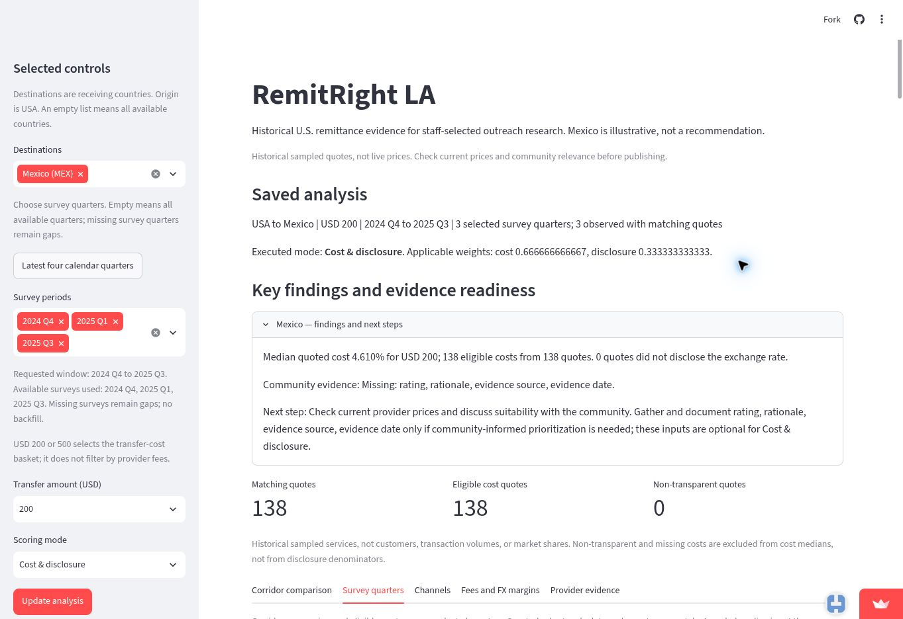

*Figure 1. Saved analysis: 138 matching and eligible quotes, zero non-transparent quotes. The displayed 4.610% is a pooled three-survey median, not a quarterly result or an average of quarterly medians.*

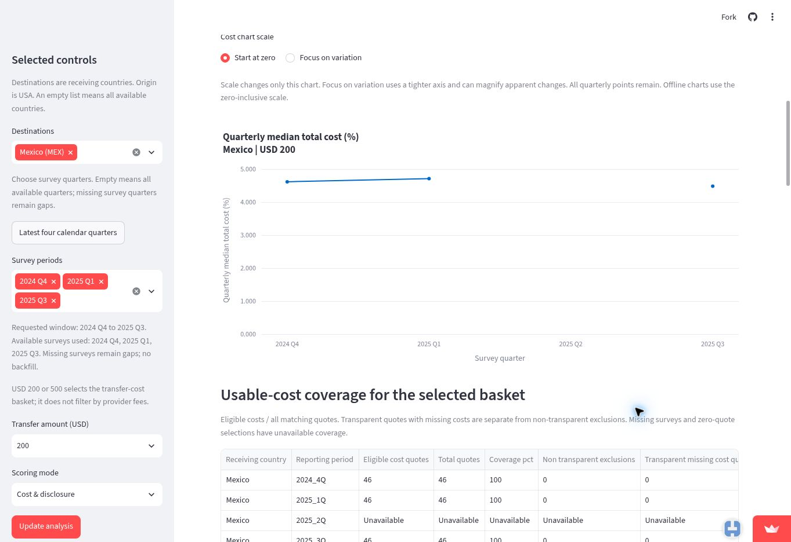

*Figure 2. Quarterly chart: the first two observed points rise; Q3 is lower, separated by a missing Q2 interval. The coverage table is partly cut off here; Figure 3 supplies its complete rows.*

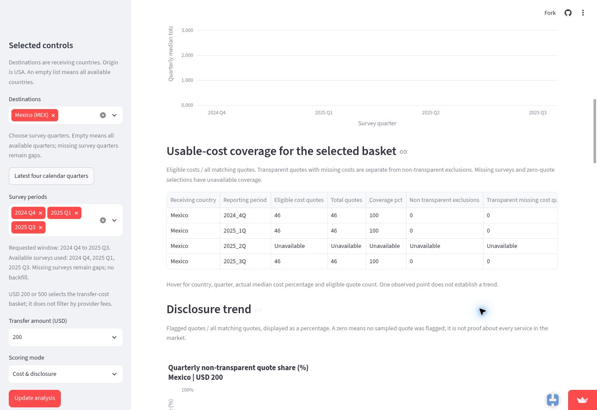

*Figure 3. Each observed quarter has 46 eligible costs from 46 quotes, 100% sample coverage, zero non-transparent exclusions and zero transparent missing costs. Q2 coverage is unavailable. The complete column labels are Receiving country; Reporting period; Eligible cost quotes; Total quotes; Coverage percentage; Non-transparent exclusions; Transparent missing cost quotes. The rightmost screenshot header is clipped; these labels and the case results table supply the missing wording.*

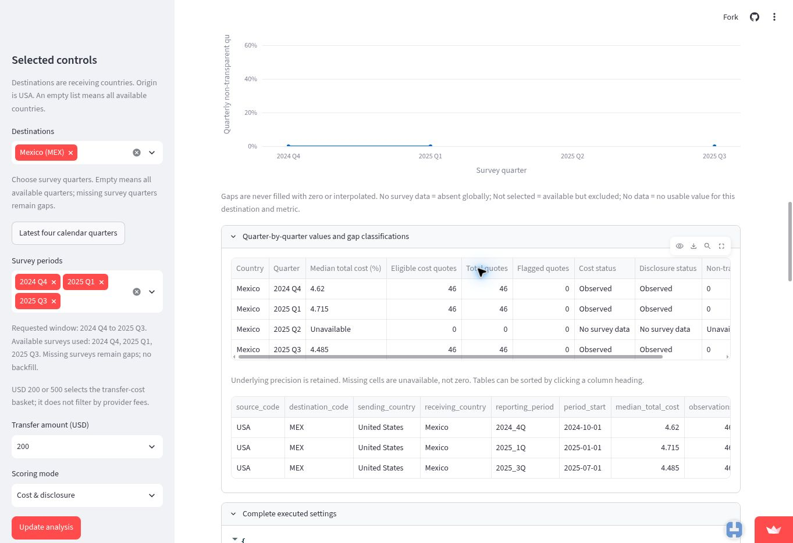

*Figure 4. The flat 0% line shows the non-transparent quote share, not transfer costs. Zero applies to the observed quarters (2024 Q4, 2025 Q1 and 2025 Q3); 2025 Q2 has no survey observations. Exact displayed medians are 4.62%, 4.715% and 4.485%. Q2 is labelled No survey data. The zero counts displayed in that missing-quarter row mean no observations, not a zero price or measured market activity. The lower raw table contains only the three observed survey quarters.*

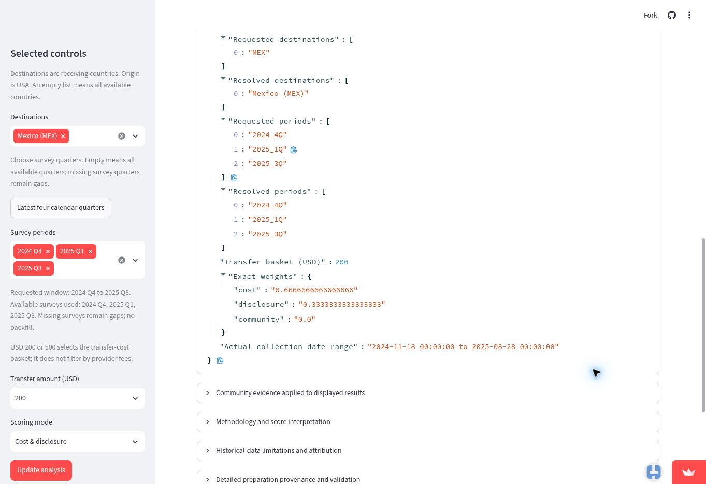

*Figure 5. Executed settings confirm MEX, the three requested/resolved surveys, USD 200, zero community weight and a collection-date range from November 18, 2024 to August 28, 2025. Figure 1 supplies the executed mode, which is above the captured portion of this settings panel.*

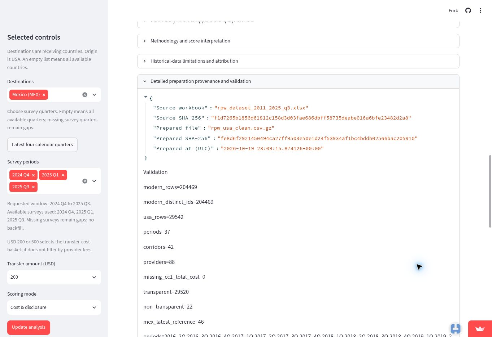

*Figure 6. The displayed Prepared SHA-256 matches the committed prepared CSV fingerprint reported in this case. The separate Source SHA-256 identifies the Excel workbook and is not the value used for the prepared-data comparison. Matching data fingerprints do not identify the deployed code commit.*

### 4. Reading the result for their decision

**Does the number measure what this person cares about?** It supports a limited publication statement: the middle quoted total-cost percentage among eligible sampled services in each observed quarter. It does not measure the typical customer's expense or the price change of a verified unchanged product. The independently calculated quarterly medians match Figure 4; Figure 3 confirms coverage. The pooled 4.610% in Figure 1 answers a different question and must not replace the quarterly series.

The dashboard supplies quarterly inspection, coverage, gaps, service evidence and saved settings. Service-profile matching and common-profile medians below were calculated separately from the data; they are not dashboard features.

**Who is in the rows, and who is not?** Rows are surveyed service quotes, not customers or completed transfers. All 46 recorded quotes are eligible in each selected observed quarter. This is complete usable-cost coverage within the samples, not complete market coverage. Actual transaction volumes, customers' choices and household resources are absent.

Equal counts conceal changes. The independent comparison uses seven fields: `firm`, `payment_instrument`, `access_point`, `pickup_method`, `cc1_lcu_code`, `cc1_lcu_amount` and `cc1_denomination_amount`. Each field is casefolded, whitespace is collapsed, comma-separated tokens are sorted and rejoined, and other spelling and punctuation are retained. There is no numeric recoding, provider aliasing or matching by quote ID. Prices and collection dates are excluded from the key. Each quarter has 46 unique keys, so no ambiguous matches were assigned. All 46 basic profiles match Q4 to Q1, but only 43 are common across all three surveys. Their medians are 4.610%, 4.700% and 4.600%. These profiles are not proven persistent product identities; transfer speed and other attributes can change. The different subset results show sensitivity to sample definition, not that composition caused the full-sample movement. A stricter sensitivity rule adds firm type, pickup location, transfer speed and receiving-network coverage: 31 profiles are common, with medians 4.610%, 4.590% and 4.370%. The matching rule therefore matters; neither subset is a validated fixed-product panel.

**What outside the data matters to this decision?** Publication scope matters: a description of sampled quotes needs different evidence from a claim about household affordability. RPW's snapshot design and potentially omitted recipient charges constrain interpretation ([World Bank methodology](https://remittanceprices.worldbank.org/methodology)). Causal explanations require additional evidence.

Starting-point sensitivity is material. Independent longer-history calculations, keeping the endpoint at 2025 Q3 (4.485%), show:

| Starting quarter | Starting median | Endpoint comparison |
|---|---:|---|
| 2023 Q4 | 4.300% | Final median higher |
| 2024 Q1 | 4.700% | Final median lower |
| 2024 Q3 | 4.485% | Same displayed median |
| Selected start: 2024 Q4 | 4.620% | Final median lower |

The verification script reports the full 37-quarter available history as well as these comparisons. This sensitivity check does not replace the selected window; it is independent calculated evidence rather than a dashboard screenshot.

**What could they wrongly conclude from it?** A lower final median could be mistaken for a steady decline, unchanged products becoming cheaper, consumer savings, improved affordability or a policy effect. Q1 is higher than Q4, Q2 is missing, service profiles differ and the data lack customer outcomes or a causal comparison. Relevant Module 11 issues include one row per what, the real thing or a stand-in, which dates belong and same mix.

**Reproducible independent check.** `cases/elena/verification/verify_elena_trends.py` is a clearly labelled reconstruction of the earlier in-memory investigation, rerun for this review. It uses only the Python standard library, reads the exact committed prepared-data blob, verifies its SHA-256, rejects duplicate profile keys, and imports no application calculation helpers. It checks prepared data; it does not repeat the earlier independent Excel-source comparison. Full saved output: `cases/elena/verification/elena-verification-output.txt`.

Run the verification script from the application folder, prof-build-M2. Regardless of the checked-out branch, it reads the frozen prepared CSV stored at commit 208b0375 through git show and requires the SHA-256 verified in the supplied live-dashboard screenshots. It does not read the working-folder CSV or establish the deployed code commit.

```text
uv run python ../cases/elena/verification/verify_elena_trends.py
```

The calculation and profile-key functions are:

```python
def median(rows):
    values = sorted(Decimal(row['cc1_total_cost_pct']) for row in rows if eligible(row))
    n = len(values)
    return (values[(n - 1) // 2] + values[n // 2]) / 2 if n else None

def normalized(value):
    tokens = (' '.join(token.casefold().split()) for token in value.split(','))
    return '|'.join(sorted(tokens))

def signature(row, fields=FIELDS):
    return tuple(normalized(row[field]) for field in fields)
```

Rerun output excerpt (costs in percent; differences in percentage points):

```text
QUARTERS: total eligible nontransparent transparent_missing median_pct
2024_4Q 46 46 0 0 4.620
2025_1Q 46 46 0 0 4.715
2025_2Q 0 0 0 0 Unavailable
2025_3Q 46 46 0 0 4.485
2025_2Q rows in complete committed USA data: 0

Pair matches: 2024_4Q 2025_1Q 46
Pair matches: 2025_1Q 2025_3Q 43
Basic profiles common to all three: 43
COMMON BASIC MEDIANS: period profiles median_pct
2024_4Q 43 4.610
2025_1Q 43 4.700
2025_3Q 43 4.600

START SENSITIVITY: start median_pct endpoint_minus_start_percentage_points
2023_4Q 4.300 0.185
2024_1Q 4.700 -0.215
2024_3Q 4.485 0.000
2024_4Q 4.620 -0.135
```

The Q2 zeros count records in this file; they are not observed prices or zero market activity. All selected observed rows are eligible, so the recorded-row and eligible-row profile populations coincide.

### 5. The verdict: prove or break

**Publication verdict: approve a narrowly descriptive statement.** The supplied live images confirm the quarterly values, coverage, executed settings and matching prepared-data fingerprint. The supported briefing statement is:

> In the checked World Bank RPW USA-Mexico USD 200 samples, median quoted total cost was 4.620% in 2024 Q4, 4.715% in 2025 Q1 and 4.485% in 2025 Q3. Each observed quarter contained 46 eligible quotes; 2025 Q2 was missing. The samples did not contain identical recorded service profiles, so these figures describe sampled quotes rather than a measured price change for unchanged products or consumers.

Elena is better equipped with the dashboard as an inspection and briefing tool combined with independent source checks. It brings quarterly results, coverage, explicit gaps and settings together. The official corridor page remains useful for service details; independent workbook calculations permit comparability checks; published reports provide broader context. This is a reasoned assessment of the app's features, not a measured productivity benefit. It does not establish individual savings, affordability improvements, nationwide trends or policy effects.

**Break finding:** the app correctly reports these sampled medians, but coverage counts alone do not show changes in service composition. Existing root requests CR-05, CR-06 and CR-09 address calendar selection, coverage and service-table exploration. The general limitation already says survey composition changes; a compact quarter-by-quarter composition comparison would make that warning more actionable. The recommended change below supplements those requests without changing data, scoring or existing medians.

**Change request**

```markdown
### CR-11: Show quarterly service composition beside historical trends

- **From:** Nicharee Ratanajaratkul (Prae), 2026-11-07
- **Part:** Survey quarters view and exported briefing.
- **Evidence:** The three selected Mexico quarters each contain 46 eligible USD 200 quotes, but separate analysis finds only 43 basic service profiles common across all three. Full-sample and common-profile medians differ.
- **Change:** Add per-quarter provider and payment/access/payout-category counts beside the cost and coverage evidence. Explain that equal counts do not establish unchanged services. Retain existing medians, expose missing categories and do not automatically assert product matches. This supports other corridors and historical users without changing scores or other users' answers.
- **Priority:** medium
- **Status:** open
```

## 2.2 Ana - illustrative CHIRLA outreach researcher

**Author:** Kanishk Balasubramaniae.

### Ana's Mexico remittance workshop

**Bottom line:** Use the online-versus-counter comparison as one section of a broader workshop. Combine it with current provider quotes and conversations about participants' circumstances. The app does not establish guaranteed savings, channel popularity or who should switch online.

### 1. The person and the decision

Ana is an illustrative outreach researcher at CHIRLA, not an interviewed employee. Before preparing a workshop for people sending money from the United States to Mexico, she must decide whether online-versus-counter costs should be its main focus. Choosing poorly could use limited workshop time on advice that offers little practical benefit or does not fit participants' circumstances.

### 2. Their real situation and alternatives

CHIRLA's [Community Education & Outreach](https://www.chirla.org/what-we-do/programs-initiatives/community-education-outreach/) page includes financial literacy and consumer protection workshops. It lists "Financial access and literacy," supporting this case's setting without establishing that CHIRLA currently runs this particular workshop.

Ana's alternatives include investigating the World Bank price database directly, comparing current provider quotes and talking with participants. The World Bank's [Remittance Prices Worldwide methodology](https://remittanceprices.worldbank.org/methodology) describes its prices as a "snapshot of a moment in time" and explains that costs include fees and exchange-rate margins. Historical prices therefore need a current-price check. The Consumer Financial Protection Bureau (CFPB)'s [Problems sending money to another country?](https://www.consumerfinance.gov/consumer-tools/sending-money/) describes the information generally available before payment: costs, exchange rates and the expected recipient amount. Its guidance says consumers "can shop around and compare costs with other companies." These quotes can support current choices; participant discussions can address needs and stable, secure internet access absent from the price data. These discussions are proposed, not interviews conducted for this case.

### 3. The app in use

**Live app:** [RemitRight LA](https://project-c2b8ykvnwmkqm8o59iqymy.streamlit.app/), checked November 7, 2026.

**Selections:** United States origin; Mexico; Q3 2025; USD 200 basket; Cost & disclosure mode. Click **Update analysis**, then **Channels**. No community rating is required for this comparison.

| Channel | Eligible / total quotes | Median total cost |
|---|---:|---:|
| Internet-only | 29 / 29 | 4.01% |
| Counter-only | 15 / 15 | 4.60% |
| Other/unknown | 2 / 2 | 4.73% |

There are no Mixed quotes. All 46 quotes are eligible, with an overall median of 4.485%. Counter minus Internet is **0.59 percentage points**, equivalent to **$1.18 on $200**. These are separate groups of historical service quotes.


**Live-app evidence: channel comparison and access questions**

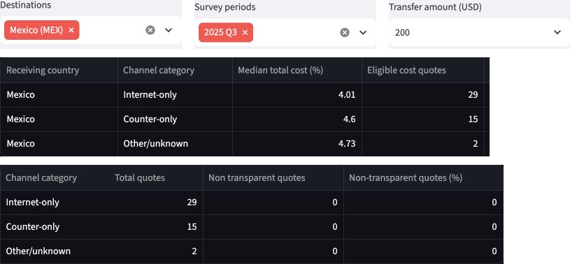

*Figure 1. All columns of the live channel table, arranged in two panels with channel labels repeated for readability. The selections above the table show Mexico, Q3 2025 and USD 200; the mode is Cost & disclosure.*

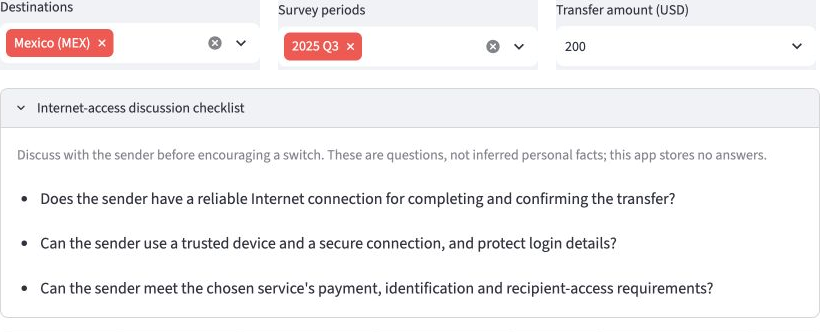

*Figure 2. The checklist asks about reliable internet, a trusted device and secure connection, and payment, identification and recipient requirements. The app does not infer or store participants' answers.*

Both figures use genuine public-app screenshots, cropped and arranged for readability. Original captures are retained; no values or wording were changed.


### 4. Reading the result for their decision

**Does it measure what Ana cares about?** The $1.18 difference gives Ana a concrete cost example for one section of the workshop. It measures the difference between two group medians, not what a particular participant would save. It is insufficient on its own to choose the workshop's main focus.

**Who is in the rows, and who is not?** This is Module 11 **Kind 1: one row per what?** One prepared row is a sampled provider/service observation containing costs for two transfer baskets. The view selects USA-to-Mexico observations from Q3 2025 and uses the $200 field. Medians require transparency and an observed cost; here all 46 qualify. The two Other/unknown observations remain separate from the 29 Internet and 15 Counter observations. These are quotes, not customers, completed transactions or identified Los Angeles workshop participants. More Internet quotes do not show more users or more frequent sending.

**What outside the data matters?** Whether a person has stable, secure internet access matters before discussing a switch. The checklist prompts this conversation but does not answer it. Participants' circumstances and current provider prices must be checked separately, consistent with the World Bank's snapshot limitation and the CFPB's comparison guidance in Part 2.

**What could Ana wrongly conclude?** Both that everyone will save $1.18 by switching online and that more Internet quotes mean more people use online services. Neither follows from these rows. Different services and customers may differ in other ways; this comparison does not establish that switching causes savings.

**Independent calculation:** The appendix includes the complete code and actual output from `cases/ana/check_ana_channels.py`. This uses sorted Decimal values rather than the app's pandas aggregation. It reproduced Internet 4.010% (29 quotes), Counter 4.600% (15), Other/unknown 4.730% (2), the overall 4.485% median and the $1.18 difference. No costs were excluded. Results matched the live display at its shown precision; minor floating-point tails in the CSV explain extra digits. This checks aggregation, not the original workbook cleaning, survey representativeness or today's prices.

### 5. The verdict: prove or break

The current comparison and access checklist are sufficient for one section of a broader workshop, when combined with current quotes and participant conversations. The dashboard puts medians, sample sizes, the dollar difference and suitability questions together, making the historical comparison easier to explain than examining the underlying World Bank records alone.

The independent calculation confirms the numbers used here. The visible sample counts, separate channel categories, causal warning and access checklist support the limited discussion use Ana needs. Current provider quotes remain necessary for current prices; participant conversations remain necessary for personal circumstances. The available quote data cannot settle those questions.

I would keep this feature for that limited purpose and make no additional change request for this case. Ana should not use it to promise savings, infer channel popularity, recommend that everyone switch, or choose the workshop's main topic on price evidence alone.


#### Appendix: independent calculation

Complete code for the check summarized in Part 4. Save it as `cases/ana/check_ana_channels.py`. From the team repo, change into `prof-build-M2`, then run `uv run python ../cases/ana/check_ana_channels.py`. The script reads prepared data and imports none of the app calculation functions.

```python
import csv
from decimal import Decimal
import gzip
from pathlib import Path
ROOT = Path(__file__).resolve().parents[2]
groups = {name: [] for name in ('Internet-only', 'Counter-only', 'Mixed', 'Other/unknown')}
counts = dict.fromkeys(groups, 0)
excluded = 0
def middle(values):
    ordered = sorted(values)
    n = len(ordered)
    return ordered[n // 2] if n % 2 else (ordered[n // 2 - 1] + ordered[n // 2]) / 2
with gzip.open(ROOT / 'prof-build-M2/data/rpw_usa_clean.csv.gz', 'rt', newline='') as source:
    for row in csv.DictReader(source):
        if (row['source_code'], row['destination_code'], row['period']) != ('USA', 'MEX', '2025_3Q'):
            continue
        words = {part.strip().lower() for part in row['access_point'].split(',') if part.strip()}
        known = {'internet', 'agent', 'bank branch', 'post office branch', 'call center'}
        online = 'internet' in words
        counter = bool(words & {'agent', 'bank branch', 'post office branch'})
        channel = ('Other/unknown' if not words or words - known else
                   'Mixed' if online and counter else 'Internet-only' if online else
                   'Counter-only' if counter else 'Other/unknown')
        counts[channel] += 1
        value = row['cc1_total_cost_pct'].strip()
        if row['transparent'].strip().lower() != 'yes' or not value:
            excluded += 1
            continue
        cost = Decimal(value)
        if not cost.is_finite():
            raise ValueError('Nonfinite cost')
        groups[channel].append(cost)
print('USA to Mexico | USD 200 | Q3 2025')
print('Channel | total quotes | eligible costs | median cost (%)')
for channel, values in groups.items():
    median = f'{middle(values):.3f}' if values else 'Unavailable'
    print(f'{channel} | {counts[channel]} | {len(values)} | {median}')
delta = middle(groups['Counter-only']) - middle(groups['Internet-only'])
print(f'Counter minus Internet: {delta:.3f} percentage points')
print(f'Dollar equivalent: ${delta * Decimal(200) / 100:.2f}')
print(f'All-quote median: {middle([cost for values in groups.values() for cost in values]):.3f}%')
print(f'Excluded non-transparent or missing costs: {excluded}')
assert len(groups['Internet-only']) == 29
assert len(groups['Counter-only']) == 15
# Match the displayed precision; the prepared CSV retains floating-point tails.
assert middle(groups['Internet-only']).quantize(Decimal('.001')) == Decimal('4.010')
assert middle(groups['Counter-only']).quantize(Decimal('.001')) == Decimal('4.600')
assert delta.quantize(Decimal('.001')) == Decimal('0.590')
print('Comparison with live medians and counts: MATCH')
```

**Actual output:**

```text
USA to Mexico | USD 200 | Q3 2025
Channel | total quotes | eligible costs | median cost (%)
Internet-only | 29 | 29 | 4.010
Counter-only | 15 | 15 | 4.600
Mixed | 0 | 0 | Unavailable
Other/unknown | 2 | 2 | 4.730
Counter minus Internet: 0.590 percentage points
Dollar equivalent: $1.18
All-quote median: 4.485%
Excluded non-transparent or missing costs: 0
Comparison with live medians and counts: MATCH
```

## 2.3 Ana - fictional sender needing cash pickup

**Author:** Yuqian Chen.

### Ana: choosing a USD 200 cash-pickup transfer to Mexico

**To Ana:** Use RemitRight LA to explore historical services, then compare current recipient amounts and confirm cash-pickup conditions with providers before choosing. Do not treat its historical cost ranking or sender-channel labels as a current, usable offer for your mother.

**Prepared by Yuqian Chen · November 8, 2026**

### 1. The person and the decision

Ana is a fictional Los Angeles resident who wants to send USD 200 to her mother in Mexico today. Her mother needs to collect the money in cash. Ana must decide which provider to use for this transfer; choosing poorly could leave her mother with less money or a service she cannot use. This is a difficult case at the boundary of RemitRight LA's intended use, which is historical research rather than live provider selection.

### 2. Their real situation and alternatives

Ana needs an actual transfer quote and a workable cash-pickup option. The CFPB explains that pre-payment information includes the exchange rate, fees/taxes and recipient amount; availability information also matters ([CFPB, Send money abroad with more confidence](https://www.consumerfinance.gov/consumer-tools/money-transfers/send-money-abroad-with-more-confidence/)). This supports comparing what her mother would receive, rather than choosing from a historical cost percentage alone.

An alternative is a provider's current estimator and agent locator. Western Union's Mexico page offers these tools and says cost depends on payment method, payout method and the exchange rate at transfer time. Its cash-pickup FAQ says recipients typically need valid ID and an MTCN at a participating agent. Ana should confirm an accessible location and timing with her mother ([Western Union, Send money to Mexico](https://www.westernunion.com/us/en/send-money-to-mexico.html)). This is an example alternative, not a recommendation or a claim that Western Union is cheapest. No live transaction quote has been collected for Ana.

**Sources:**

- Consumer Financial Protection Bureau, [Send money abroad with more confidence](https://www.consumerfinance.gov/consumer-tools/money-transfers/send-money-abroad-with-more-confidence/), accessed November 8, 2026. Supporting points: pre-payment price components and recipient amount; availability information.
- Western Union, [Send money to Mexico](https://www.westernunion.com/us/en/send-money-to-mexico.html), accessed November 8, 2026. Supporting sections: cheapest transfer, price estimator, and cash-pickup FAQ.

### 3. The app in use

**Live link:** https://project-c2b8ykvnwmkqm8o59iqymy.streamlit.app/

**What they select:** Mexico (MEX), survey period 2025 Q3, USD 200, Cost & disclosure mode. Click Update analysis. The saved analysis confirms one selected survey quarter, 2025 Q3; cost weight is 2/3 and disclosure weight is 1/3.

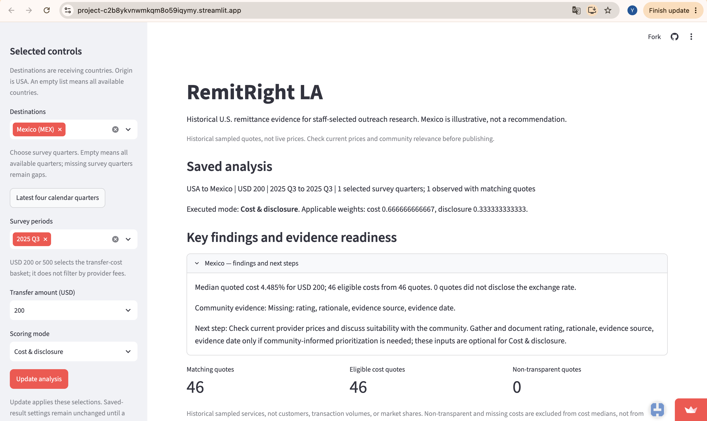

**Provider evidence, left-hand columns:** Same saved analysis: Mexico, 2025 Q3, USD 200, Cost & disclosure. The screenshot shows provider identity, historical collection date, sender channel, total cost and disclosure status. It is a partial view of the 46-row export.

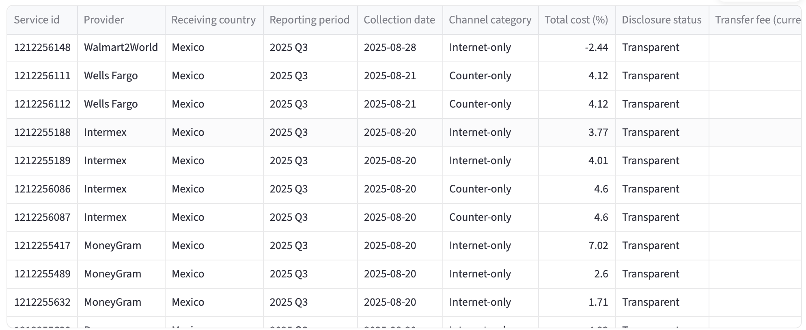

**Provider evidence, right-hand columns:** The horizontally scrolled view shows FX margin and dollar cost breakdowns. Provider names are offscreen in this image; use the left view and preserved CSV for row identity. The first currency header is clipped, so currency should be checked in the full export rather than inferred from the cropped text.

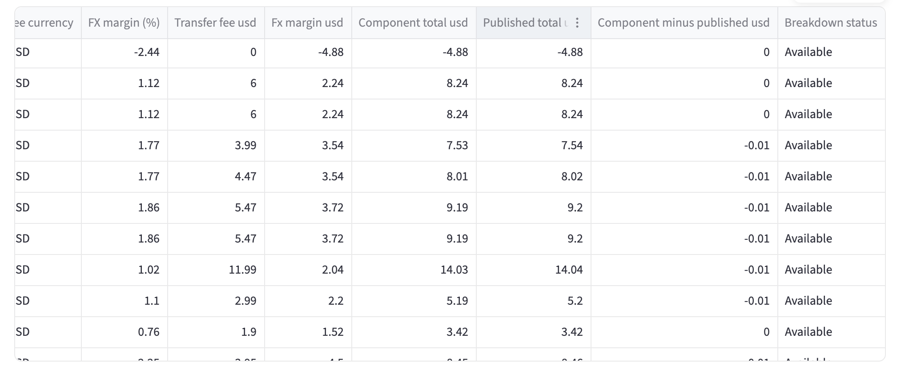

**What they see:** The saved live result shows a 4.485% median quoted cost, 46 eligible costs from 46 quotes and zero quotes flagged for not disclosing the exchange rate. The overview explicitly warns that these are historical sampled quotes. The provider views retain collection dates and cost components; the complete export is preserved in `cases/ana-cash-pickup/evidence/ana-provider-export.csv`.

### 4. Reading the result for their decision

**Does the number measure what this person cares about?** Only partly. The 4.485% median describes the historical USD 200 quotes selected, not today's best usable cash-pickup offer or the pesos her mother would receive. This is a date mismatch (kind 5) and a stand-in for her actual outcome (kind 3). The screen labels the data historical. The exported provider table contains dated service quotes, not a current quote for Ana.

**Who is in the rows, and who is not?** The exported table contains 46 Mexico service quotes labelled 2025 Q3. These are quotes, not 46 customers or transfers. Its columns contain no cash-pickup eligibility, payout location, recipient identification requirement or arrival-time field. Missing fields do not prove that providers lack these services; the export simply cannot establish which offers meet Ana's needs. The PDF identifies the USD 200 basket; the CSV itself has no transfer-amount column.

**What outside the data matters to this decision?** Current exchange rate, fees, recipient pesos, and cash-pickup availability matter, along with a reachable agent, required identification and timing. The CFPB and Western Union sources in Part 2 support these checks. Ana's mother's exact location and documents are not specified in this fictional case, so suitability remains unresolved.

**What could they wrongly conclude from it?** Ana might treat the lowest historical cost as today's cheapest usable offer, or interpret Internet-only as a statement about how her mother receives the money. Neither follows from the exported fields. Sender channel and recipient payout method are different questions. The app can help her explore historical services, but she still needs a current cash-pickup quote.

Check of the preserved live-app export, using Python's standard-library CSV reader and decimal median rather than the app's pandas calculation. Script: `cases/ana-cash-pickup/verification/verify_ana_export.py`.

Command from the team repository:

```text
python3 cases/ana-cash-pickup/verification/verify_ana_export.py
```

```text
Rows: 46
Countries: Mexico
Periods: 2025 Q3
Eligible transparent costs: 46
Median total cost (%): 4.485
Collection dates: 2025-08-04 to 2025-08-28
```

This checks arithmetic on the exported values, not independent raw-workbook preparation or today's price. The script also prints every export column, allowing the missing payout-information fields to be checked.

### 5. The verdict: prove or break

**Verdict:** Ana cannot select a provider from this dashboard alone. RemitRight LA is useful as historical background and for identifying services to investigate, but the provider's current estimator and pickup information are more directly relevant to her final transaction decision. She must compare current recipient amounts and confirm cash-pickup conditions. This is a limitation for this difficult case, not proof that the historical research app computes its results incorrectly. The page already warns that quotes are historical; a change request, if adopted, should address the remaining payout-method ambiguity without pretending to supply live prices.

#### CR-13: Clarify sender channel versus recipient payout method

- **From:** Yuqian Chen (YuqianC0724), 2026-11-08
- **Part:** RemitRight LA Streamlit provider evidence table and offline briefing
- **Evidence:** In the Ana case, the public dashboard was set to Mexico, 2025 Q3, USD 200 and Cost & disclosure. The saved result showed 46 quotes and a 4.485% median. The provider screenshot includes Walmart2World, collected 2025-08-28, labelled Internet-only. The complete 46-row CSV contains channel categories and historical cost components but no recipient payout method, pickup location, arrival time or recipient-ID requirements. Ana needs her mother to collect cash. Internet-only does not establish whether that requirement is met. Existing historical-price and row-order warnings help, but do not explicitly explain this distinction.
- **Change:** Add a short explanation next to the provider table and in the offline briefing: “Channel category describes how the sender accesses the service, not how the recipient receives the money. Confirm cash pickup, location, identification requirements and current prices with the provider.” Do not infer payout availability from the channel category or add unsupported live-price claims. Keep historical quotes, sorting, scores and calculations unchanged. This also helps researchers interpreting channel comparisons and does not change Elena's historical trend evidence.
- **Priority:** medium
- **Status:** open

## 2.4 Lea - transfer schedule

**Author:** edijiang0431.

### Lea’s case: Five transfers or two?

Bottom line. Two $500 transfers had lower estimated historical costs on 50 of 57 paired service records. Lea can use that pattern to decide which schedule to price first. The current quotes and her family’s timing needs should determine the actual schedule.

### 1. The person and the decision

Lea is a fictional hospital employee in Los Angeles who wants to send $1,000 in savings principal to family in the Philippines over the next five months. She is deciding whether to send $200 five times or $500 twice. Her family can wait for the larger installments, and Lea can set aside enough for either schedule. She wants to avoid repeated charges while getting the money there before her family needs it.

### 2. Their real situation and alternatives

Lea can ask her family when the funds need to arrive and which deposit or pickup options they can use. She can then request both amounts from the same provider using the same funding and delivery methods. The CFPB explains that prepayment disclosures show the exchange rate, fees and taxes, and expected amount received. It also notes that recipient-bank charges or foreign taxes can reduce what arrives. [1] The World Bank’s public Remittance Prices Worldwide site offers a historical benchmark at both $200 and $500. Its methodology explains that prices are snapshots and that costs include the exchange-rate margin as well as the transfer fee. RemitRight LA makes the selected corridor and quarter easy to inspect. A provider’s current quote is the better source for pricing a transfer Lea is ready to make. [2]

#### Sources

[1] Consumer Financial Protection Bureau. [Send money abroad with more confidence](https://www.consumerfinance.gov/consumer-tools/money-transfers/send-money-abroad-with-more-confidence/).

[2] World Bank, Remittance Prices Worldwide. [Methodology](https://remittanceprices.worldbank.org/methodology).

### 3. The app in use

Open [RemitRight LA](https://project-c2b8ykvnwmkqm8o59iqymy.streamlit.app/). Select Philippines, 2025 Q3 and Cost & disclosure. Run Update analysis at USD 200, then change only the transfer amount to USD 500 and run Update analysis again.


*Figure 1. Saved analysis confirms the route, quarter and $500 basket.*

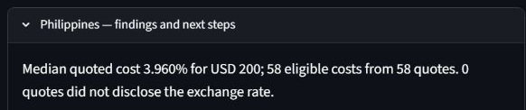

*Figure 2. $200 basket: 3.960% median across 58 eligible quotes.*

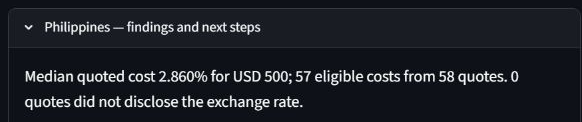

*Figure 3. $500 basket: 2.860% median across 57 eligible quotes.*

The two runs each found 58 historical service records. Both reported zero quotes flagged for exchange-rate nondisclosure. The $500 cost median uses one fewer record. Screenshots are cropped from the live app to show the saved settings and the cost findings.

### 4. Reading the result for their decision

Does the number fit? The app shows the median quoted cost rate for a single transfer. Lea cares about the dollar cost of a schedule. Multiplying the displayed rates by $1,000 gives historical benchmarks of $39.60 and $28.60. The $11.00 gap compares two medians with different eligible sets. It does not measure what Lea would save on the same service.

Who is in the rows? The project’s cleaned RPW file has 58 U.S.-to-Philippines service records from August 2025. Each row describes a sampled service and its quote terms, without weighting by customer use. One Ria cash-funded agent/cash-pickup record has a $200 cost (5.49%) and a blank $500 cost. That row cannot support a paired comparison. Actual transfers and services outside the sample are outside the comparison.

Paired check. In rpw_usa_clean.csv.gz, filter destination PHL and period 2025_3Q. On each row with both cc1_total_cost_pct and cc2_total_cost_pct, calculate five times the $200 quote’s dollar cost minus twice the $500 quote’s dollar cost. Equivalently, subtract the two percentage values and multiply by 10. Of 57 pairs, 50 favored two transfers, 6 tied, and 1 favored five. The median paired difference was $13.10 in favor of two.

What could Lea misread? Treating the pooled medians as a same-service comparison is a same mix problem (11.5, kind 7). For one Western Union online credit-card quote to a bank account, the rates were 3.46% and 5.36%. Under the same historical-price assumption, two transfers cost $19.00 more on that service. A schedule that looks cheaper in the pooled view can cost more for a specific option.

What else matters? Repeating a historical quote assumes its terms hold across installments. Future rates, fees and delivery times can change. Lea also has to confirm when her family needs the money, how they can receive it and whether recipient-side charges apply. [1, 2]

### 5. The verdict: break

The app is useful for seeing how often a larger transfer was cheaper in the historical sample. For choosing a schedule, Lea is better off comparing current quotes for both amounts on services her family can use. The app’s corridor median cannot establish her savings or the pesos her family will receive. Change request for RemitRight LA. Add an optional paired-basket view within a corridor and quarter. Use only records with eligible costs at both amounts. Show the paired and excluded counts, the two implied costs per $1,000, and the distribution of paired differences. Label the results as historical and explain the constant-price assumption. Keep the existing corridor view available for outreach and trend users.

## 2.5 Ana - illustrative IFAD project officer

**Author:** Jiayi Liu. Individual case memo dated November 7, 2026.

### Choosing one corridor for further research

Recommendation: Use the dashboard to build a shortlist, but do not choose the one priority corridor from its ranking alone. Afghanistan has the highest observed median cost. The evidence does not establish where further research would be most useful.

### 1. The person and the decision

Ana is a fictional project officer in IFAD's Financing Facility for Remittances (FFR). She has resources to investigate only one U.S.-origin remittance corridor first for opportunities to reduce costs. A poor choice could waste staff time and funding. Ana, her resource limit and this assignment are scenario assumptions, not a documented IFAD project.

### 2. Her real situation and alternatives

IFAD's FFR overview describes research into remittance flows, costs, regulations and market participants [1]. This supports Ana's role; it does not establish a procedure for choosing one U.S.-origin corridor. For this scenario, she needs both evidence of a price problem and a realistic opportunity to improve it. Her alternatives include reviewing World Bank records directly, reading IFAD research, and consulting providers, country specialists and recipient communities. The dashboard organizes historical comparisons and service details, reducing the need to filter and summarize source records separately. It does not replace current local information. The World Bank describes its prices as snapshots and notes that some recipient-side charges are not tracked [2].

### 3. The app in use

Public app: https://project-c2b8ykvnwmkqm8o59iqymy.streamlit.app/ Executed selections: USA origin; all 42 receiving countries; 2025 Q3 only; USD 200; Cost & disclosure. Applied weights are two-thirds cost and one-third disclosure. Figure 1 shows these settings and the app's advice about missing community evidence. The supplied public-app screenshots were captured on November 7, 2026. The five highest corridor cost medians and quote counts match the earlier local check (Figure 2). Provider-name counts below come from the separate prepared-CSV check; they are not displayed in that comparison screenshot.

| Receiving country | Median total cost (%) | Eligible quotes | Provider names* |
|---|---:|---:|---:|
| Afghanistan | 8.875 | 6 | 3 |
| Cuba | 7.750 | 4 | 3 |
| Bangladesh | 7.525 | 24 | 9 |
| Guyana | 7.350 | 21 | 5 |
| Armenia | 6.950 | 16 | 5 |

*Recorded provider names, without consolidating related companies. Screenshots are excerpts, not the complete dataset. Details checked only in the prepared CSV are identified below.

### 4. Reading the result for her decision

Does the number measure what Ana cares about? Partly. Median cost identifies expensive sampled services, while Ana needs to know where research is most worthwhile. Cost is a stand-in for that broader goal (kind 3). All 1,010 selected quotes are marked transparent, so the disclosure term is zero throughout. The score ranks these corridors in the same order as their cost medians; it adds no evidence about affected families, research feasibility or likely benefits.

Who is in the rows, and who is not? Each row is a sampled service quote, not a customer, transaction or independent provider. The prepared-CSV check found six Afghanistan quotes: MoneyGram (3), Western Union (2) and Walmart2World (1). More quotes in Bangladesh do not establish more users or greater need. These summaries are not weighted by actual use and do not show all recipients' circumstances.

Are the services comparable? Amount and quarter are fixed, but service mixes differ. The CSV check found cash receiving for all six Afghanistan quotes; Bangladesh also includes bank accounts and mobile wallets. The public channel table separates Afghanistan into four Internet-only quotes and two counter-only quotes and warns about both small groups (Figure 4). This raises kind 7, "same mix?" It does not demonstrate Simpson's paradox or that switching channels causes savings.

What outside the data matters? Ana still needs current prices and services, corridor flows, recipient access, regulations, potential partners and realistic cost-reduction opportunities. The data used here are from 2025 Q3. The CSV check found five of Afghanistan's six pickup-location fields blank; that does not prove cash pickup is unavailable. The app already advises checking current prices and consulting the community (Figure 1). Community inputs are optional in Cost & disclosure; their absence is not a cost-calculation error.

For Afghanistan, the public fee/FX view shows a median fee of USD 7.745 and a median FX margin of 4.945% (Figure 3). These have different units, and separately calculated component medians cannot simply be added to reconstruct the 8.875% median total cost. Historical quotations can also omit some recipient charges [2].

### 5. The verdict: prove or break

Break for Ana's full decision. The app helps her form a shortlist and inspect historical costs, but it does not support choosing one priority corridor on its own. Organized comparisons are useful alongside source records and local consultation. The ranking must not be used as a complete resource-allocation rule or a description of today's prices. No single corridor is selected in this case; Ana's original decision remains unresolved.

CR-14: Show provider breadth beside corridor results. The request is recorded as open in the local team working copy of change-requests.md. It asks for distinct provider-name counts and the largest provider's count/share of eligible quotes beside each corridor and in exported briefings. Afghanistan would show three names and MoneyGram's 3/6 (50%). These must be labeled as sample composition, not market shares, with existing costs and scores unchanged.

This would help outreach researchers and advocacy writers as well as Ana judge the evidence. It would not supply the additional information needed for her one-corridor choice. At preparation, CR-14 was not implemented, committed or pushed.

#### Sources

[1] IFAD. Financing Facility for Remittances. Official overview. https://www.ifad.org/en/remittances/financing-facility-for-remittances

[2] World Bank. Remittance Prices Worldwide: Methodology. https://remittanceprices.worldbank.org/methodology

Both official pages were checked on November 7, 2026. Additional provider-level details above come from the prepared-CSV check documented in the case working memo.

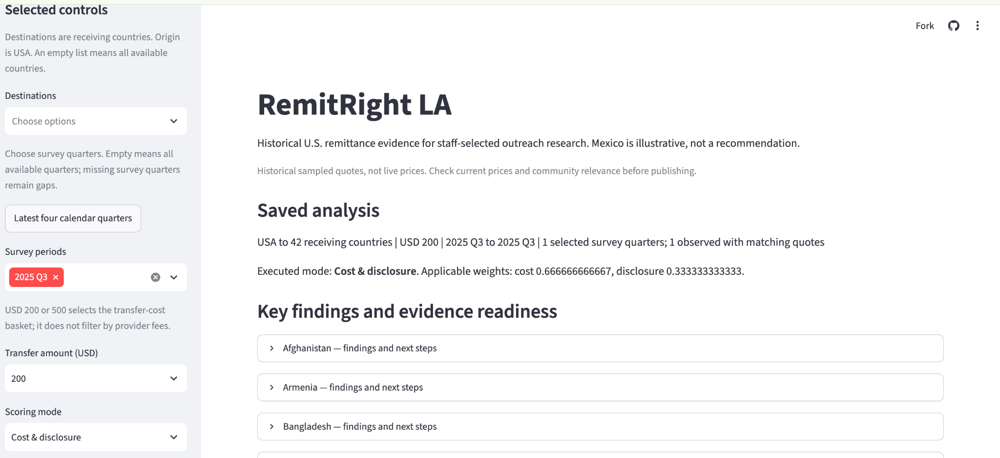

*Figure 1. Executed settings and existing guidance USA to all 42 receiving countries | 2025 Q3 | USD 200 | Cost & disclosure. The saved run shows the applied two-thirds/one-third weights. The lower excerpt is the Afghanistan guidance panel from the same run. Afghanistan guidance excerpt: missing community inputs are optional in this mode; the app recommends current-price and community checks.*

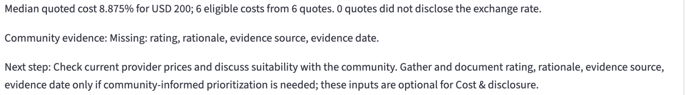

*Figure 1. Executed settings and existing guidance USA to all 42 receiving countries | 2025 Q3 | USD 200 | Cost & disclosure. The saved run shows the applied two-thirds/one-third weights. The lower excerpt is the Afghanistan guidance panel from the same run. Afghanistan guidance excerpt: missing community inputs are optional in this mode; the app recommends current-price and community checks.*

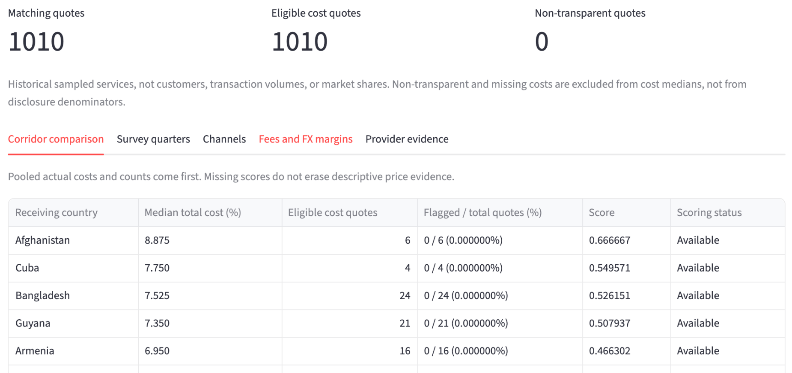

*Figure 2. Highest corridor medians in the public run Same executed settings as Figure 1. The view reports 1,010 eligible quotes and zero non-transparent quotes. This excerpt preserves the five highest corridor rows; it is not the complete 42-country table. Reading: Afghanistan is 8.875% from six quotes; Cuba is 7.750% from four; Bangladesh is 7.525% from 24. These are descriptive results for sampled services, not transaction-weighted market costs or a research-priority rule.*


*Figure 3. Public fee and FX evidence Two excerpts from the same original screenshot: the public address bar and the app view. Selected controls remain visible. Afghanistan shows USD 7.745 median fee and 4.945% median FX margin, each from six observations; component medians are not additive.*

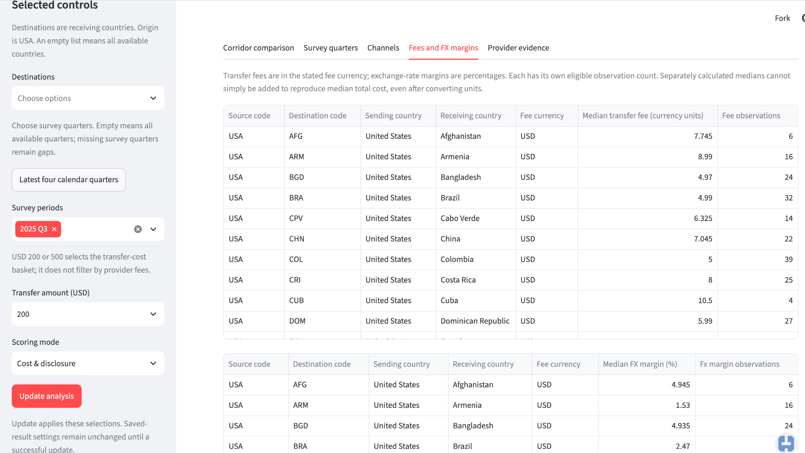

*Figure 3. Public fee and FX evidence Two excerpts from the same original screenshot: the public address bar and the app view. Selected controls remain visible. Afghanistan shows USD 7.745 median fee and 4.945% median FX margin, each from six observations; component medians are not additive.*


*Figure 4. Channel composition and sample-size warnings Two excerpts from the same original screenshot, using the same 42-country run. Afghanistan has four Internet-only and two counter-only quotes. Both groups receive small-sample warnings. The displayed channel difference is descriptive, not guaranteed individual savings.*

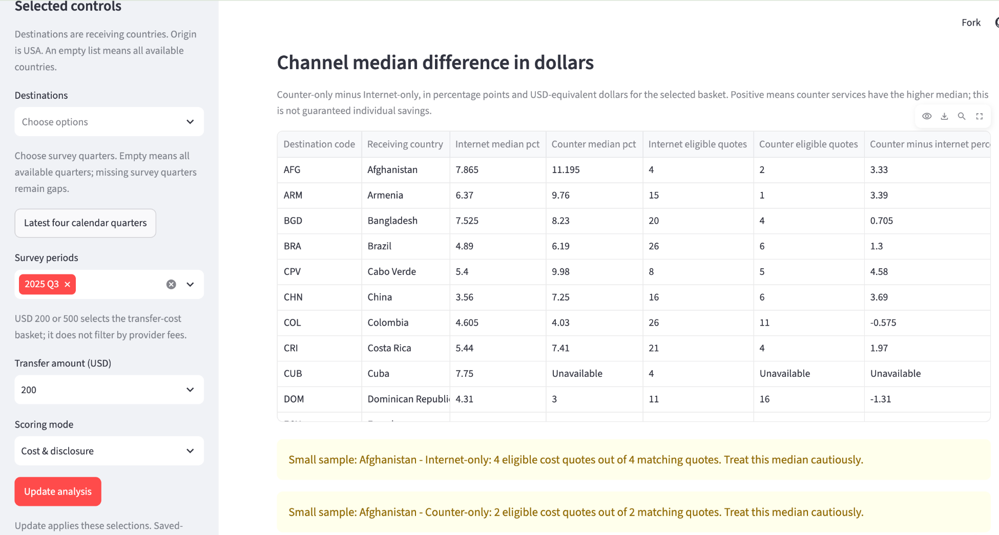

*Figure 4. Channel composition and sample-size warnings Two excerpts from the same original screenshot, using the same 42-country run. Afghanistan has four Internet-only and two counter-only quotes. Both groups receive small-sample warnings. The displayed channel difference is descriptive, not guaranteed individual savings.*

# 3. Numbers

The checked dashboard calculations agree with independent calculations from the prepared quote data. This section defines the main measures, shows the results for the team's cases, and explains apparent differences that should not be treated as calculation errors. Correct arithmetic does not establish current prices, individual savings or the right campaign priority.

## 3.1 Data, method and evidence

We checked the prepared World Bank Remittance Prices Worldwide file used by RemitRight LA: **29,542 USA-origin service-quote records**, with 29,542 distinct service IDs, 37 survey periods and 42 destination corridors. Each row is a provider/service observation containing the two surveyed transfer baskets, not a customer or a completed transfer. All-country Q3 2025 selections contain **1,010 quotes**.

The independent checker reads the gzip CSV with Python's standard-library CSV reader. It groups records with dictionaries, sorts Decimal values to calculate medians, and computes counts, shares, dollar equivalents and weighted scores separately from the app's pandas calculations. Application functions are called only to produce the comparison values, not the independent answers. Exact counts and category states must agree; numeric values must agree within **0.000000001 in their stated units**, allowing harmless floating-point differences.

The verification is recorded at code commit `82200456fc44746f38ee354ac33142bc0255b023`. The checked prepared-file SHA-256 is:

```text
fe8d6f2921450494ca27ff9503e50e1d24f53934af1bc4bddb02566bac205910
```

**Reproduce:** from the team repository, run:

```text
cd prof-build-M2
uv run python ../verification/check_mvp_numbers.py
```

Evidence files:

- [Independent checker](verification/check_mvp_numbers.py).
- [Full comparison ledger](verification/mvp-number-comparisons.csv): selection, metric, independent value, application/case value and pass/fail result.
- [Run output](verification/mvp-number-output.txt) and [machine-readable summary](verification/mvp-number-summary.json).

The numerical sweep covers all corridors with records in Q3 2025 at both USD 200 and USD 500, default Cost & disclosure, community mode with and without ACS evidence, Mexico's latest-four-quarter window, and a historical Mexico selection with a non-transparent quote. It checks corridor, quarter and channel summaries; fee and FX summaries; fee minima, maxima and zero counts; service-level dollar breakdowns; reference bounds; scores; missing states; and calendar coverage. The ledger contains many scalar comparisons of these outputs, not that many independent surveys or test-suite cases.

## 3.2 Counts, eligibility and median total cost

**Total quotes** counts all matching service records, including non-transparent records and records missing a cost. **Eligible cost quotes** counts matching records marked `transparent = yes` with an observed cost for the selected basket. **Median total cost (%)** is the median of those eligible cost percentages. For an even count, the middle two costs are averaged. These are quote-weighted calculations, not customer- or transaction-weighted estimates.

**Non-transparent quote share** is the number marked `transparent = no` divided by **all matching quotes**, not by eligible cost quotes. The percentage display multiplies that fraction by 100. **Cost coverage (%)** is eligible cost quotes divided by all matching quotes, multiplied by 100. No denominator means unavailable, not zero.

| Selection | Independent result | Application result | Finding |
|---|---|---|---|
| Mexico, Q3 2025, USD 200 | 46 total; 46 eligible; median 4.485%; 0 flagged | Same | Match |
| Philippines, Q3 2025, USD 200 | 58 total; 58 eligible; median 3.960%; 0 flagged | Same | Match |
| Philippines, Q3 2025, USD 500 | 58 total; 57 eligible; median 2.860%; 0 flagged | Same | Match |
| Mexico, Q1 2017, USD 200 | 26 total; 25 eligible; median 4.760%; 1 flagged | Same | Match |

The older Mexico selection checks a real exclusion: the disclosure share is **1/26 = 3.846154%**, while the cost median uses 25 quotes. For the Philippines USD 500 selection, one transparent quote has no USD 500 cost: coverage is **57/58 = 98.275862%**, not 100%. A missing cost is not a zero-price offer. Source: the independent ledger and summary above.

The app's corridor ranking also matches the independent Q3 2025 USD 200 medians. The five highest are Afghanistan **8.875% (6 eligible quotes)**, Cuba **7.750% (4)**, Bangladesh **7.525% (24)**, Guyana **7.350% (21)** and Armenia **6.950% (16)**. Their small or unequal samples remain an interpretation limit; a correct ranking is not a measure of market size or need. These are the figures used in Jiayi Liu's case.

**Live cross-check, November 8, 2026:** [public dashboard](https://project-c2b8ykvnwmkqm8o59iqymy.streamlit.app/), USA to Mexico, Q3 2025, USD 200, Cost & disclosure. After Update analysis, the live view showed 46/46 eligible quotes, a 4.485% median and zero flagged quotes, matching the separate calculation.

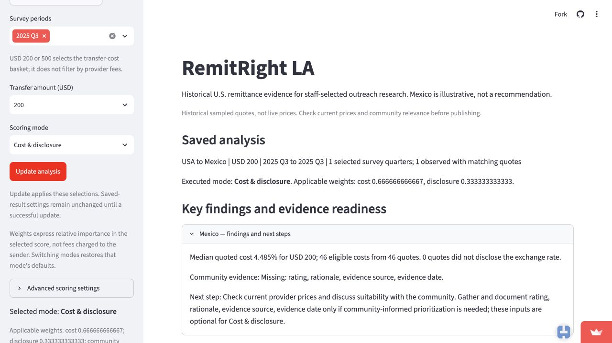

## 3.3 Channel comparison and dollar difference

Channels describe **sender access**, not the recipient's payout method. Records with Internet access only are Internet-only; agent, bank-branch or post-office access without Internet is Counter-only; both is Mixed. Unrecognized or absent access descriptions remain Other/unknown, rather than being assigned to a preferred channel. Medians and eligibility use the same rules as the corridor view.

For the workshop case, Mexico, Q3 2025, USD 200:

| Channel | Total / eligible quotes | Independent median | Application median |
|---|---:|---:|---:|
| Internet-only | 29 / 29 | 4.010% | 4.010% |
| Counter-only | 15 / 15 | 4.600% | 4.600% |
| Other/unknown | 2 / 2 | 4.730% | 4.730% |

There are no Mixed quotes in this selection. Counter minus Internet is **4.600 - 4.010 = 0.590 percentage points**. Its dollar equivalent is **0.590 / 100 × USD 200 = USD 1.18**. Both the independent calculation and the application agree. This is a difference between medians of separate groups, not guaranteed savings from switching. The two Other/unknown quotes do not justify a broad claim about that category.

## 3.4 Quarterly trends, coverage and sample composition

Quarterly medians use eligible records **within each quarter**. A pooled multi-quarter median uses all eligible quote rows together; it is not an average of quarterly medians. The latest-four-calendar-quarter preset requests **2024 Q4, 2025 Q1, 2025 Q2 and 2025 Q3**. Because 2025 Q2 is absent from the prepared USA data, it remains a gap rather than being replaced by an older quarter.

| Mexico, USD 200 | Total / eligible quotes | Independent median | Application median / state |
|---|---:|---:|---|
| 2024 Q4 | 46 / 46 | 4.620% | 4.620% |
| 2025 Q1 | 46 / 46 | 4.715% | 4.715% |
| 2025 Q2 | No records | Unavailable | No survey data; no median |
| 2025 Q3 | 46 / 46 | 4.485% | 4.485% |

Observed-quarter cost coverage is 100%; coverage for the missing survey quarter is unavailable. Zero records in the file do not mean zero remittance activity or zero cost.

**Supporting Elena case calculation, not a built-in dashboard metric:** matching the seven recorded profile fields used in her case leaves 43 basic profiles common to the three observed quarters. Their medians are 4.610%, 4.700% and 4.600%, respectively. These independently reproduced figures differ from the full-sample medians because the populations differ. They do not demonstrate a dashboard error or prove unchanged products; field matches are not established product identities. The full-sample endpoint difference is **-0.135 percentage points**; the common-profile endpoint difference is **-0.010 percentage points**. A trend statement must identify which population it describes. The profile definition is preserved in the checker.

## 3.5 Fees, FX margins and service-level dollars

**Median transfer fee** is in the recorded fee currency; **median FX margin** is a percentage of the selected transfer basket. Each uses transparent records with an observed value for that component, grouped by corridor and fee currency. Their eligible counts can differ from the total-cost count. The checker independently reproduces these medians, component counts, fee minima/maxima and zero-fee counts.

For Afghanistan, Q3 2025, USD 200, the independent and application results are the same: **median fee USD 7.745**, **median FX margin 4.945%**, and six observed values for each. The total-cost median is **8.875%**. Adding the separate component medians gives **7.745/200 × 100 + 4.945 = 8.8175%**, which is a different calculation: a median of sums need not equal the sum of medians.

At service level, the checker verifies each displayed component from the corresponding prepared row:

```text
FX-margin dollars = FX-margin percent × selected basket / 100
Component total dollars = USD fee + FX-margin dollars
Published total dollars = published total-cost percent × basket / 100
Difference = component total dollars - published total dollars
```

Non-transparent, missing or non-USD fee components remain unknown/unavailable; the app does not invent conversions or substitute zero. Published totals and component-derived totals remain separate. In the checked Q3 records, their largest absolute difference is **USD 0.02**, for service ID `1212255537` at the USD 500 basket. The independent calculation reproduces that difference. The two fields describe different calculations from published components; source rounding may contribute, but its original cause was not independently established. This is not an unexplained discrepancy between the app and the independent method.

## 3.6 Relative cost and the two score modes

Relative cost is `(corridor median - reference minimum) / (reference maximum - reference minimum)`. The reference uses **all available USA-origin corridors for the selected periods and basket**, before filtering the countries displayed. It is not recalculated using only the visible shortlist. With fewer than two valid reference corridors it is unavailable; with equal reference medians it is zero, which does not mean free transfers.

For Q3 2025, USD 200, the independent reference bounds are **2.470% and 8.875%**, matching the application. Mexico's normalized cost is approximately **0.314598**.

| Mode and default formula | Mexico independent score | Application / live display |
|---|---:|---:|
| Cost & disclosure: `(2/3 × relative cost) + (1/3 × non-transparent share)` | 0.209732 | 0.209732 |
| Community campaign priority with ACS: `(0.50 × relative cost) + (0.25 × non-transparent share) + (0.25 × community input)` | 0.244307 | 0.244307 |

These are unitless weighted indices, not cost percentages, probabilities or provider recommendations. Higher values indicate higher relative costs/non-disclosure and, in community mode, a larger documented relevance input. The checker also confirms that community mode without required evidence gives an unavailable score, not zero, while Cost & disclosure needs no community rating. Valid weights must sum to one; inputs are not silently redistributed.

For ACS evidence, we checked the saved official [Census ACS 2024 five-year Table B05006, Los Angeles County](https://data.census.gov/table/ACSDT5Y2024.B05006?g=050XX00US06037). The source describes **2020–2024**, not a single 2024 census count. Mexico's country-of-birth estimate is **1,141,433**, with a **90% margin of error of ±9,233**; the county foreign-born total is **3,279,681**. The app's 0–5 rating is `5 × country estimate / county total`, then divided by five in scoring. The normalized input is therefore **0.348031714**, or **34.803171%**. This checks the arithmetic of a project-defined population proxy, not the validity of population as a measure of remittance need.

The independent mapping and raw-value checks reproduce 41 country matches; South Sudan remains unavailable instead of inheriting Sudan's population. Changing displayed countries leaves Mexico's ACS score unchanged. Sampling margins are displayed in the evidence, but not propagated into the composite score. Other researcher-supplied ratings remain judgments; their predictive or decision validity is not established by a numerical check.

**Live cross-check:** same Mexico, Q3 2025, USD 200 selection; choose ACS community-size proxy, Load community evidence, Community campaign priority, then Update analysis. The live score was **0.244307**, matching the independent calculation rounded to six decimals.

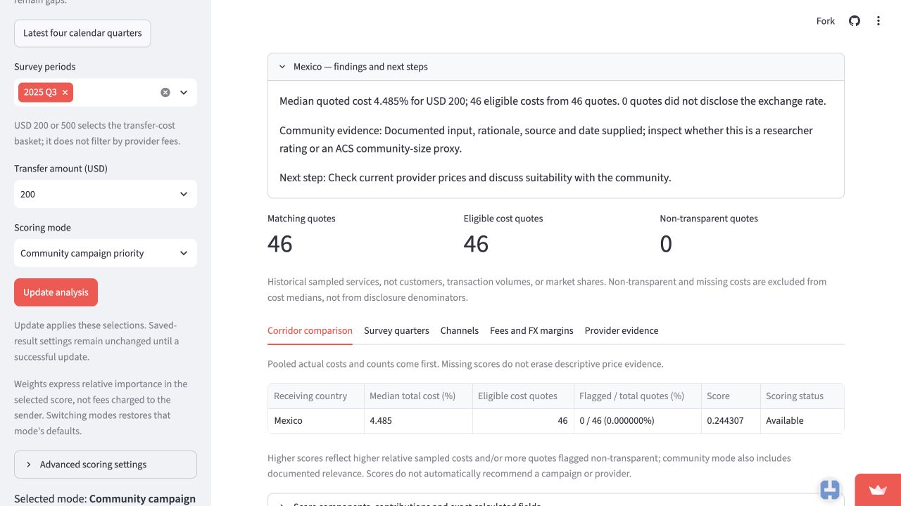

## 3.7 Checking the Philippines schedule comparison

Lea's case compares five USD 200 transfers with two USD 500 transfers, each schedule moving USD 1,000 in principal. Multiplying the two pooled median rates by USD 1,000 produces **USD 39.60** and **USD 28.60**, a **USD 11.00** gap. These medians use different eligible sets, so that gap is not a same-service saving.

The independent paired analysis retains only records with transparent, observed costs at **both** amounts. For each retained service, it calculates:

```text
Five-transfer cost = 5 × 200 × USD-200 cost percent / 100
Two-transfer cost = 2 × 500 × USD-500 cost percent / 100
Paired difference = 10 × (USD-200 cost percent - USD-500 cost percent)
```

There are **57 pairs**: **50** favor two larger transfers, **6** tie and **1** favors five smaller transfers. The median paired difference is **USD 13.10**. These reproduce Lea's reported check; they are supporting case calculations, not a paired-basket feature currently displayed by the dashboard. Differences smaller than USD 0.000000001 are treated as floating-point ties. The USD 13.10 paired median differs legitimately from the USD 11.00 difference between pooled medians: the calculations and eligible populations differ. Both assume historical terms repeated across installments, not guaranteed future prices.

## 3.8 Results, reconciliation and limits

The final run completed **20,194 scalar comparisons with zero failures**. The full ledger includes counts, numeric values, missing states and case-analysis comparisons. We also checked the preserved 46-row public provider export from the cash-pickup case: its median is 4.485%, matching the independently read Mexico data. Live checks of the Mexico baseline and ACS score agree with the separate calculations; other case screenshots and their recorded settings remain in [cases/](cases/README.md).

No application calculation changes were needed. Tiny binary floating-point tails are handled by the stated tolerance and display rounding. Missing evidence, missing quarters, different component medians, different eligible baskets and different service populations explain the apparent differences above; they are not filled, merged or relabeled to force agreement.

This verifies arithmetic on the specified prepared-data version and selections. It does **not** independently redo the source workbook extraction, verify every possible future filter/input combination, establish survey representativeness, confirm today's prices, validate personal circumstances, or prove that a score identifies the best campaign. Part 2 interprets fitness for users' decisions; Part 4 explains the regression tests. This section supplies the numerical evidence for those discussions.

# 4. Tests

**DRAFT INSERTION POINT - team contribution required.** Summarize tested properties, hand-worked examples, independent checks and additions beyond the starting build, with evidence and remaining gaps. This section is incomplete.
